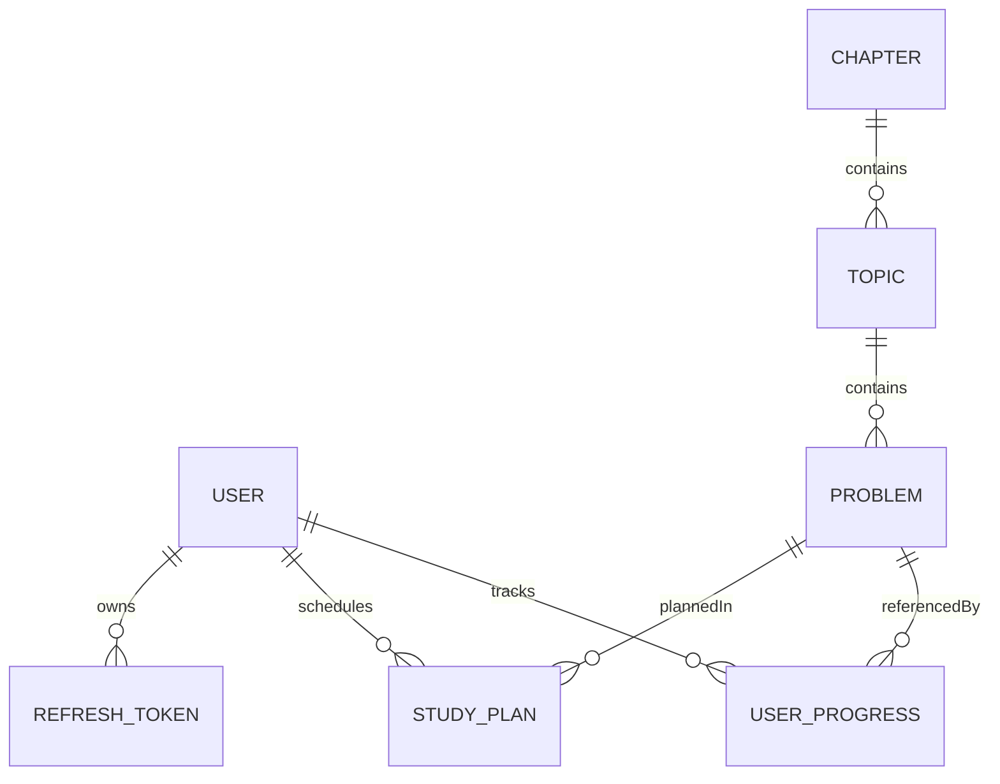
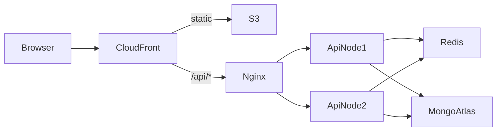

# DSA Sheet Web App: Plan

## 1. What the PDF asks for

**Features (all required)**
- Secure login for students.
- A sheet organised as Chapter, then Topic, then Problem, in a clear hierarchy that's easy to navigate.
- Each chapter broken down into topics and problems.
- Each problem links to a YouTube video, a LeetCode or Codeforces problem, and an article.
- Each problem is tagged Easy, Medium or Hard.
- A checkbox on each problem. On the next login the student resumes exactly where they left off.
- A calendar page where students plan, track and revisit their study schedule. The PDF calls it a core, standalone feature, not a widget inside another page.

**System design (the main thing being judged)**
- HLD:
  - Architecture diagram.
  - Request flow.
  - How authentication works.
  - Data flow for progress tracking.
  - Scalability for 10k-50k active users.
- LLD:
  - Collections: Users, Topics, Problems, UserProgress.
  - Relationships between them.
  - Indexing strategy.
- Bonus: API design, scalability improvements, and design trade-offs. Do all three, since they matter most for a Tech Lead role.

**Deliverables**
- Source code.
- Live AWS link.
- System Design document.
- DB Schema document.
- A 2-5 minute video covering the app flow, key features and progress tracking.

**Resume note:** your summary says "3+ years", but Oct 2022 to now is 4 years. Update it to 4+ before you submit. Your strongest matching points are AWS (EC2, S3, CloudWatch), JWT with RBAC, Redis, and leading a team of 10+. The project should show off those skills.

---

## 2. Tech stack (kept simple)

- **Monorepo** using npm workspaces, with three parts:
  - `apps/api`
  - `apps/web`
  - `packages/shared`: Zod schemas and TypeScript types shared by the API and the frontend.
- **Backend:**
  - Node 20, Express and TypeScript.
  - Mongoose for MongoDB, Zod for validation.
  - Pino for logging; helmet, cors and rate-limiting middleware.
  - bcrypt for passwords, jsonwebtoken for tokens.
  - ioredis, which is optional and can be turned off with a flag.
- **Frontend:**
  - React and Vite with TypeScript.
  - React Router for pages.
  - TanStack Query for server data, Zustand for auth state.
  - Tailwind for styling.
  - FullCalendar (or react-big-calendar) for the calendar page.
- **Database:** MongoDB Atlas on the free M0 tier, as a replica set in the AWS Mumbai region (ap-south-1). The design docs name M10 as the production size.
- **Cache:** Redis in Docker on the same EC2 instance, which is free. The docs name ElastiCache as the production choice.
- **Deploy:**
  - Frontend on S3 behind CloudFront.
  - API in Docker on EC2 behind Nginx.
  - CI/CD with GitHub Actions.

---

## 3. Folder structure (detailed layout, simple code)

```
dsa-sheet/
  apps/
    api/src/
      config/          env.ts (zod-validated), db.ts, redis.ts, logger.ts
      middlewares/     auth.ts, validate.ts, errorHandler.ts, rateLimit.ts, notFound.ts
      modules/
        auth/          auth.routes.ts, auth.controller.ts, auth.service.ts, auth.schema.ts
        users/         user.model.ts, user.service.ts, ...
        sheet/         chapter.model.ts, topic.model.ts, problem.model.ts, sheet.service.ts, ...
        progress/      progress.model.ts, progress.service.ts, ...
        calendar/      plan.model.ts, calendar.service.ts, ...
      utils/           ApiError.ts, asyncHandler.ts, cache.ts, jwt.ts
      scripts/         seed.ts (sheet content from a JSON file)
      app.ts, server.ts
    web/src/
      app/             router.tsx, providers.tsx, queryClient.ts
      features/
        auth/          pages/, components/, api.ts, store.ts
        sheet/         pages/, components/, api.ts, hooks.ts
        progress/      hooks.ts (optimistic toggle)
        calendar/      pages/, components/, api.ts
        dashboard/     pages/ (stats, continue where you left off)
      components/ui/   Button, Checkbox, Badge, Modal, Spinner
      lib/             http.ts (axios + 401 refresh), utils.ts
  packages/shared/src/ types.ts, schemas.ts, constants.ts (Difficulty enum)
  infra/               docker-compose.yml, nginx.conf, Dockerfile.api
  docs/                SYSTEM_DESIGN.md, DB_SCHEMA.md, API.md, adr/ (filled in the last phase)
  .github/workflows/   ci.yml, deploy.yml
```

Every backend module uses the same layers: routes, then controller, then service, then model. Controllers stay thin and services hold the logic. There's no separate repository layer, because Mongoose already does that job.

---

## 4. Database design



**Content collections.** These are the same for every user, read-heavy and rarely written, so they're good candidates for caching.
- **chapters**
  - Fields: `title`, `slug`, `order`, `description`.
  - Index: unique on `slug`, plus `order`.
- **topics**
  - Fields: `chapterId`, `title`, `slug`, `order`.
  - Index: on `{chapterId, order}`.
- **problems**
  - Fields:
    - `topicId` and `chapterId`. `chapterId` is copied onto each problem so chapter stats don't need a lookup.
    - `title`, `slug`, `difficulty` (Easy, Medium or Hard), `order`.
    - `resources: { youtube, leetcode, codeforces, article }`.
  - Indexes: `{topicId, order}`, `{chapterId}`, `{difficulty}`, and unique on `slug`.

**User collections.** These grow with the number of users and are write-heavy.
- **users**
  - Fields: `name`, `email` (lowercase), `passwordHash`, `role` (student or admin).
  - `lastActivity: { problemId, topicId, chapterId, at }` is what powers resuming where you left off.
  - Index: unique on `email`.
- **userprogress**: one document per user per problem.
  - Fields: `userId`, `problemId`, `topicId`, `chapterId`, `status` (done or revisit), `completedAt`, `notes?`.
  - Indexes:
    - Unique on `{userId, problemId}`, which makes upserts idempotent.
    - `{userId, chapterId}` for per-chapter stats.
    - `{userId, completedAt}` for the streak and activity heatmap.
  - **Why not an array inside the user document:** an array grows without limit, every update rewrites the whole document, and concurrent toggles conflict. Separate documents keep writes small and atomic.
- **studyplans**: calendar entries.
  - Fields: `userId`, `date` (day, stored in UTC), `title`, `problemIds[]`, `topicId?`, `status` (planned, done or missed), `note`.
  - Index: `{userId, date}` for range queries such as "give me this month".
- **refreshtokens**
  - Fields: `userId`, `tokenHash`, `expiresAt`.
  - A TTL index on `expiresAt` makes MongoDB delete expired tokens automatically.

**Size estimate:** 50k users × about 400 problems is at most 20M progress documents of roughly 150 bytes each, so about 3 GB. An Atlas M10 cluster handles that comfortably with the indexes above. The demo runs on M0, which has 512 MB of storage; the seed data and test users need only a few MB. The schema and indexes are identical on both tiers, so going to production only means changing the cluster size, not the code.

---

## 5. System design (HLD)



- **Request flow:**
  1. CloudFront serves the React files from S3.
  2. CloudFront forwards `/api/*` to the API. Frontend and API share one domain, so there are no CORS problems and cookies are simple.
  3. Nginx passes the request to the Node API.
  4. Middleware runs in order: rate limit, auth, Zod validation.
  5. Then the controller, the service, Redis or MongoDB, and the response.
- **Authentication:**
  - Passwords are hashed with bcrypt (cost 10).
  - The access token is a JWT valid for 15 minutes.
  - The refresh token is valid for 7 days, is replaced with a new one on every use, and only its hash is stored in the database.
  - Both tokens live in httpOnly, Secure, SameSite=Lax cookies.
  - The API holds no session state, so any API instance can verify any request.
- **Progress data flow:**
  1. The user ticks a checkbox and the UI updates immediately, before the server replies (optimistic update).
  2. The browser calls `PUT /progress/:problemId {done:true}`. It sends the new state rather than "toggle", so retries and double-clicks are safe.
  3. The server upserts the document using the `{userId, problemId}` index and updates `user.lastActivity`.
  4. If the request fails, the UI rolls the checkbox back.
- **Resume on login:**
  1. The browser calls `GET /progress/me`, which returns the IDs of the user's completed problems in one indexed query.
  2. It calls `GET /sheet`, which comes from cache.
  3. The browser combines the two.
  4. The dashboard shows a "Continue" link based on `lastActivity`, and the sheet scrolls to and opens that topic.
- **Scale (10k-50k active users):**
  - **Load estimate:** about 10% concurrent (5k users) making about 1 request per 10 seconds gives roughly 500 requests per second at peak. Two Node instances can handle that.
  - **API:** no session state, so you scale out by adding instances. The Node cluster module or PM2 uses every CPU core on a machine.
  - **Sheet content:** cached in Redis for 1 hour, with an ETag and a `Cache-Control` header. The cache is cleared when the content is seeded or edited.
  - **Database:**
    - Atlas connection pool size of 50.
    - `.lean()` on all read queries.
    - Projections so queries only fetch the fields they need.
    - Paged date-range queries for the calendar.
  - **Rate limiting:** stored in Redis, so the limit is shared across all instances. Auth routes get a stricter limit.
  - **Production basics:**
    - gzip compression.
    - Health check at `/health`.
    - Graceful shutdown.
    - Logs and alarms in CloudWatch.
- **Future scale, documented only (not built):**
  - Application Load Balancer with an Auto Scaling Group, or ECS Fargate.
  - ElastiCache in cluster mode.
  - Atlas read replicas for stats.
  - A queue (SQS) for analytics events.
  - Moving leaderboards and stats to precomputed totals.

---

## 6. API (v1)

- **Auth:**
  - `POST /api/v1/auth/register`
  - `POST /api/v1/auth/login`
  - `POST /api/v1/auth/refresh`
  - `POST /api/v1/auth/logout`
  - `GET /api/v1/auth/me`
- **Sheet:**
  - `GET /api/v1/sheet` returns the full tree, cached.
  - `GET /api/v1/sheet/chapters/:slug`
  - `GET /api/v1/problems?difficulty=&topic=`
- **Progress:**
  - `GET /api/v1/progress/me` returns completed problem IDs and `lastActivity`.
  - `PUT /api/v1/progress/:problemId` with body `{status}`.
  - `DELETE /api/v1/progress/:problemId`
  - `GET /api/v1/progress/stats` returns totals by difficulty and chapter, and the streak.
- **Calendar:**
  - `GET /api/v1/plans?from=&to=`
  - `POST /api/v1/plans`
  - `PATCH /api/v1/plans/:id`
  - `DELETE /api/v1/plans/:id`
  - `POST /api/v1/plans/generate` with body `{startDate, endDate, perDay}`, which auto-fills the schedule.
- **Admin (optional, protected by RBAC):** create, update and delete for chapters, topics and problems.

Every response uses the same shape: `{ success, data, error }`. Errors use a single central `ApiError` class.

---

## 7. Calendar (a core feature, so build it well)

- A full page with month and week views.
- Click a day to create a plan. Problems can be added to it from a sidebar or the sheet. Dragging events is optional.
- A plan's status comes from progress: it's done when all its problems are done, and missed when the date has passed without that.
- A study heatmap and streak, built from `completedAt`.
- "Mark for revisit" on a problem schedules revisions at +1, +3 and +7 days. This is spaced repetition and directly covers the PDF's "revisit".
- An auto-plan generator: pick a target end date and the number of problems per day, and it spreads the unsolved problems across the days.

---

## 8. Must do, should do, ignore

**Must do**
- All seven features in the PDF, with the calendar as its own page.
- Indexes exactly as listed in section 4. The unique `{userId, problemId}` upsert is essential.
- JWT in httpOnly cookies, bcrypt, Zod validation, central error handling, rate limiting, helmet.
- A seed script with real DSA content: about 8-10 chapters and 100+ problems with real links.
- Deployment on AWS with HTTPS, plus the four documents and the video.
- A clean README with setup steps, environment variables and the architecture diagram.

**Should do (scores well for a Tech Lead)**
- Redis cache for the sheet, and Redis-backed rate limiting.
- Optimistic UI updates for progress.
- A dashboard with stats.
- GitHub Actions CI: lint, typecheck, test, build. Deploy runs automatically when you push to main.
- A few useful tests: auth and progress services (Vitest), plus a few API tests (Supertest).
- A k6 load test script with its results included in SYSTEM_DESIGN.md. That's evidence the design holds up at 10k-50k users.
- ADRs: short records of decisions, such as why separate progress documents, why cookies, and why a monorepo.
- Conventional commits, a PR template, ESLint, Prettier and Husky to show team-level standards.
- Dark mode, responsive layout, search and filter by difficulty.

**Ignore (over-engineering, or out of scope)**
- Microservices, Kubernetes, GraphQL, Next.js server-side rendering.
- WebSockets and real-time features, an email or notification service.
- OAuth and Google login, email verification, forgot password. Mention these in the docs as future work.
- An admin panel UI. Seed with the script instead and keep only the admin API.
- Payments, multi-region deployment, sharding. Mention sharding by `userId` as future work.
- Full test coverage.

---

## 9. AWS deployment (free tier, but production-shaped)

**Short answer: the whole project costs nothing.** No tech decision is weakened by this. We deploy the same architecture at a smaller size, and the design docs give the production sizes. A good Tech Lead is expected to make exactly this trade-off, so write it up as an ADR.

- **MongoDB:** Atlas M0, free forever, in ap-south-1.
  - The IP allowlist only includes the EC2 instance's address.
  - No need to switch to another provider: M0 is the best free MongoDB option, and it's a real replica set.
- **API server:** one EC2 `t3.micro` (or `t2.micro`, whichever your account's free tier lists). It runs Docker Compose with the API, Redis and Nginx.
  - Add a 2 GB swap file, because the instance only has 1 GB of RAM.
  - Use an Elastic IP and an IAM role.
  - Don't build Docker images on the instance; it will run out of memory. GitHub Actions builds them and pushes to GHCR (free), and EC2 only pulls them.
- **Frontend:** built to S3, served by CloudFront with Origin Access Control.
  - A second CloudFront origin handles `/api/*` and points at the EC2 public DNS name. CloudFront requires a domain name here, not an IP.
  - Set `app.set('trust proxy', 1)` in Express so rate limiting sees the real client IP.
- **HTTPS:** the default `*.cloudfront.net` domain comes with a free certificate.
  - No Route 53 or ACM needed, so you also avoid Route 53's $0.50 per month.
  - Add a custom domain only if you already own one.
- **Secrets:** SSM Parameter Store standard parameters, which are free.
- **Monitoring:** CloudWatch logs and one CPU alarm, both within the free limits.

**What each part costs**
- **EC2 micro:** free.
  - Accounts created before 15 July 2025 get 750 hours a month for 12 months.
  - Newer accounts get up to $200 in credits on the 6-month Free plan.
- **Public IPv4 / Elastic IP:** about $3.60 a month. The legacy free tier covers this; on newer accounts it comes out of the credits.
- **S3 and CloudFront:** free at this traffic. CloudFront's always-free tier includes 1 TB a month.
- **Atlas M0:** free.
- **Redis in Docker and GHCR:** free.
- **Avoid these, because they cost money:**
  - `t3.small` or larger instances.
  - ElastiCache.
  - NAT Gateway.
  - Application Load Balancer, about $16 a month.
  - Atlas M10, about $57 a month.
  - Extra Elastic IPs that aren't attached to anything.
- **Must do:** create an AWS Budget with a $1 alert on day 1, and stop or terminate resources after the selection process ends.

---

## 10. New libraries: keep all of them, learn before the interview

Each one is an industry-standard pick and only a small amount to learn. You'll understand them as we build, because each one is introduced in a single phase.

- **Zod** (phases 2-3): schema validation.
  - One schema gives you both runtime validation and the TypeScript type, through `z.infer`.
  - It lives in the shared package, so the API and the frontend validate the same way.
  - Learn: `z.object`, `safeParse`, `z.infer`, and a validation middleware.
- **Pino** (phase 2): fast JSON logger.
  - CloudWatch can search its JSON output.
  - Add a request ID to every log line.
  - Learn: log levels, `pino-http`, child loggers.
- **bcrypt** (phase 3): password hashing.
  - Uses a salt and a cost factor, and is deliberately slow so brute-forcing is expensive.
  - Learn: `hash` and `compare`, why cost 10-12, and why it's never encryption.
  - If the native build fails on Windows, use `bcryptjs`. It has the same API.
- **ioredis** (phase 8): Redis client for Node. You already know Redis, so this is just the driver.
  - Learn: `get`/`set` with `EX`, the cache-aside pattern, and invalidating the cache on seed.
- **Zustand** (phase 3): very small store, used only for the logged-in user.
  - TanStack Query owns all server data, so Redux would be overkill.
  - Learn: `create`, selectors, and the `persist` middleware.
- **TanStack Query** (phases 5-6): server-state cache.
  - Learn: `useQuery`, `useMutation`, optimistic updates with `onMutate` and rollback, `invalidateQueries`.

**Interview talking points:**
- **Why Zustand plus TanStack Query instead of Redux:** server state and client state are different problems, so each gets the right tool.
- **Why Zod:** one source of truth for both validation and types.

---

## 11. Build phases (one step at a time)

1. Monorepo setup: tsconfig, lint, shared package, local Mongo and Redis in docker-compose.
2. API core: config, DB, logger, error handling, validation, health check.
3. Auth module, backend and frontend.
4. Sheet models and the seed script with real data.
5. Sheet UI: chapter accordion, topics, problem rows, links, difficulty badges, filters.
6. Progress tracking: checkbox, optimistic update, resume where left off, stats dashboard.
7. Calendar: plans, month and week view, revisit, auto-generator, heatmap.
8. Hardening: Redis cache, rate limiting, index check with `explain()`, tests, k6 load test.
9. Dockerize, deploy to AWS, set up the CI/CD pipeline.
10. Docs: README, SYSTEM_DESIGN.md, DB_SCHEMA.md, API.md, ADRs, and a 2-5 minute video script.
