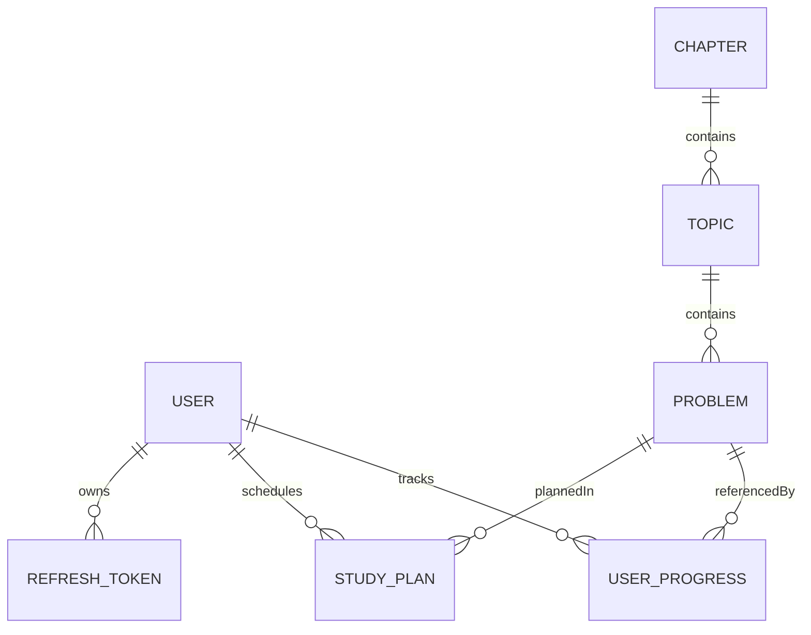
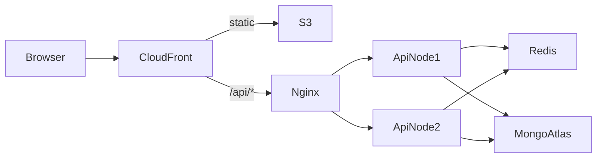

# DSA Sheet Web App: Plan

## 1. What the PDF asks for

**Features (all required)**
- Secure login for students.
- A sheet organised as Chapter, then Topic, then Problem, in a clear hierarchy that's easy to navigate.
- Each chapter broken down into topics and problems.
- Each problem links to a YouTube video, a LeetCode or Codeforces problem, and an article.
- Each problem is tagged Easy, Medium or Hard.
- A checkbox on each problem. On the next login the student resumes exactly where they left off.
- A calendar page where students plan, track and revisit their study schedule. The PDF calls it a core, standalone feature, not a widget inside another page.

**System design (the main thing being judged)**
- HLD:
  - Architecture diagram.
  - Request flow.
  - How authentication works.
  - Data flow for progress tracking.
  - Scalability for 10k-50k active users.
- LLD:
  - Collections: Users, Topics, Problems, UserProgress.
  - Relationships between them.
  - Indexing strategy.
- Bonus: API design, scalability improvements, and design trade-offs. Do all three, since they matter most for a Tech Lead role.

**Deliverables**
- Source code.
- Live AWS link.
- System Design document.
- DB Schema document.
- A 2-5 minute video covering the app flow, key features and progress tracking.


---

## 2. Tech stack (kept simple)

- **Monorepo** using npm workspaces, with three parts:
  - `apps/api`
  - `apps/web`
  - `packages/shared`: Zod schemas and TypeScript types shared by the API and the frontend.
- **Backend:**
  - Node 20, Express and TypeScript.
  - Mongoose for MongoDB, Zod for validation.
  - Pino for logging; helmet, cors and rate-limiting middleware.
  - bcrypt for passwords, jsonwebtoken for tokens.
  - ioredis, which is optional and can be turned off with a flag.
- **Frontend:**
  - React and Vite with TypeScript.
  - React Router for pages.
  - TanStack Query for server data, Zustand for auth state.
  - Tailwind for styling.
  - FullCalendar (or react-big-calendar) for the calendar page.
- **Database:** MongoDB Atlas on the free M0 tier, as a replica set in the AWS Mumbai region (ap-south-1). The design docs name M10 as the production size.
- **Cache:** Redis in Docker on the same EC2 instance, which is free. The docs name ElastiCache as the production choice.
- **Deploy:**
  - Frontend on S3 behind CloudFront.
  - API in Docker on EC2 behind Nginx.
  - CI/CD with GitHub Actions.

---

## 3. Folder structure (detailed layout, simple code)

```
dsa-sheet/
  apps/
    api/src/
      config/          env.ts (zod-validated), db.ts, redis.ts, logger.ts
      middlewares/     auth.ts, validate.ts, errorHandler.ts, rateLimit.ts, notFound.ts
      modules/
        auth/          auth.routes.ts, auth.controller.ts, auth.service.ts, auth.schema.ts
        users/         user.model.ts, user.service.ts, ...
        sheet/         chapter.model.ts, topic.model.ts, problem.model.ts, sheet.service.ts, ...
        progress/      progress.model.ts, progress.service.ts, ...
        calendar/      plan.model.ts, calendar.service.ts, ...
      utils/           ApiError.ts, asyncHandler.ts, cache.ts, jwt.ts
      scripts/         seed.ts (sheet content from a JSON file)
      app.ts, server.ts
    web/src/
      app/             router.tsx, providers.tsx, queryClient.ts
      features/
        auth/          pages/, components/, api.ts, store.ts
        sheet/         pages/, components/, api.ts, hooks.ts
        progress/      hooks.ts (optimistic toggle)
        calendar/      pages/, components/, api.ts
        dashboard/     pages/ (stats, continue where you left off)
      components/ui/   Button, Checkbox, Badge, Modal, Spinner, ThemeToggle
      lib/             http.ts (axios + 401 refresh), utils.ts
  packages/shared/src/ types.ts, schemas.ts, constants.ts (Difficulty enum)
  infra/               docker-compose.yml, nginx.conf, Dockerfile.api
  docs/                SYSTEM_DESIGN.md, DB_SCHEMA.md, API.md, adr/ (filled in the last phase)
  .github/workflows/   ci.yml, deploy.yml
```

Every backend module uses the same layers: routes, then controller, then service, then model. Controllers stay thin and services hold the logic. There's no separate repository layer, because Mongoose already does that job.

---

## 4. Database design



**Content collections.** These are the same for every user, read-heavy and rarely written, so they're good candidates for caching.
- **chapters**
  - Fields: `title`, `slug`, `order`, `description`.
  - Index: unique on `slug`, plus `order`.
- **topics**
  - Fields: `chapterId`, `title`, `slug`, `order`.
  - Index: on `{chapterId, order}`.
- **problems**
  - Fields:
    - `topicId` and `chapterId`. `chapterId` is copied onto each problem so chapter stats don't need a lookup.
    - `title`, `slug`, `difficulty` (Easy, Medium or Hard), `order`.
    - `resources: { youtube, leetcode, codeforces, article }`.
  - Indexes: `{topicId, order}`, `{chapterId}`, `{difficulty}`, and unique on `slug`.

**User collections.** These grow with the number of users and are write-heavy.
- **users**
  - Fields: `name`, `email` (lowercase), `passwordHash`, `role` (student or admin).
  - `lastActivity: { problemId, topicId, chapterId, at }` is what powers resuming where you left off.
  - Index: unique on `email`.
- **userprogress**: one document per user per problem.
  - Fields: `userId`, `problemId`, `topicId`, `chapterId`, `status` (done or revisit), `completedAt`, `notes?`.
  - Indexes:
    - Unique on `{userId, problemId}`, which makes upserts idempotent.
    - `{userId, chapterId}` for per-chapter stats.
    - `{userId, completedAt}` for the streak and activity heatmap.
  - **Why not an array inside the user document:** an array grows without limit, every update rewrites the whole document, and concurrent toggles conflict. Separate documents keep writes small and atomic.
- **studyplans**: calendar entries.
  - Fields: `userId`, `date` (day, stored in UTC), `title`, `problemIds[]`, `topicId?`, `status` (planned, done or missed), `note`.
  - Index: `{userId, date}` for range queries such as "give me this month".
- **refreshtokens**
  - Fields: `userId`, `tokenHash`, `expiresAt`.
  - A TTL index on `expiresAt` makes MongoDB delete expired tokens automatically.

**Size estimate:** 50k users × about 400 problems is at most 20M progress documents of roughly 150 bytes each, so about 3 GB. An Atlas M10 cluster handles that comfortably with the indexes above. The demo runs on M0, which has 512 MB of storage; the seed data and test users need only a few MB. The schema and indexes are identical on both tiers, so going to production only means changing the cluster size, not the code.

---

## 5. System design (HLD)



This is the target topology. The demo runs two API containers behind Nginx on a single EC2 instance (section 9 and clarification C2). It does not use separate machines.

- **Request flow:**
  1. CloudFront serves the React files from S3.
  2. CloudFront forwards `/api/*` to the API. Frontend and API share one domain, so there are no CORS problems and cookies are simple.
  3. Nginx passes the request to the Node API.
  4. Middleware runs in order: rate limit, auth, Zod validation.
  5. Then the controller, the service, Redis or MongoDB, and the response.
- **Authentication:**
  - Passwords are hashed with bcrypt (cost 10).
  - The access token is a JWT valid for 15 minutes.
  - The refresh token is valid for 7 days, is replaced with a new one on every use, and only its hash is stored in the database.
  - Both tokens live in httpOnly, Secure, SameSite=Lax cookies.
  - The API holds no session state, so any API instance can verify any request.
- **Progress data flow:**
  1. The user ticks a checkbox and the UI updates immediately, before the server replies (optimistic update).
  2. The browser calls `PUT /progress/:problemId` with body `{status: "done"}`. It sends the new state rather than "toggle", so retries and double-clicks are safe. Unticking calls `DELETE /progress/:problemId`.
  3. The server upserts the document using the `{userId, problemId}` index and updates `user.lastActivity`.
  4. If the request fails, the UI rolls the checkbox back.
- **Resume on login:**
  1. The browser calls `GET /progress/me`, which returns the IDs of the user's completed problems in one indexed query.
  2. It calls `GET /sheet`, which comes from cache.
  3. The browser combines the two.
  4. The dashboard shows a "Continue" link based on `lastActivity`, and the sheet scrolls to and opens that topic.
- **Scale (10k-50k active users):**
  - **Load estimate:** about 10% concurrent (5k users) making about 1 request per 10 seconds gives roughly 500 requests per second at peak. The working assumption is that two Node instances can handle this. It is a hypothesis until P8's k6 results confirm or revise it (section 13).
  - **API:** no session state, so you scale out by adding instances. The Node cluster module or PM2 uses every CPU core on a machine.
  - **Sheet content:** cached in Redis for 1 hour, with an ETag and a `Cache-Control` header. The cache is cleared when the content is seeded or edited.
  - **Database:**
    - Atlas connection pool size of 50.
    - `.lean()` on all read queries.
    - Projections so queries only fetch the fields they need.
    - Paged date-range queries for the calendar.
  - **Rate limiting:** stored in Redis, so the limit is shared across all instances. Auth routes get a stricter limit.
  - **Production basics:**
    - gzip compression.
    - Health check at `/health`.
    - Graceful shutdown.
    - Logs and alarms in CloudWatch.
- **Future scale, documented only (not built):**
  - Application Load Balancer with an Auto Scaling Group, or ECS Fargate.
  - ElastiCache in cluster mode.
  - Atlas read replicas for stats.
  - A queue (SQS) for analytics events.
  - Moving leaderboards and stats to precomputed totals.

---

## 6. API (v1)

- **Auth:**
  - `POST /api/v1/auth/register`
  - `POST /api/v1/auth/login`
  - `POST /api/v1/auth/refresh`
  - `POST /api/v1/auth/logout`
  - `GET /api/v1/auth/me`
- **Sheet:**
  - `GET /api/v1/sheet` returns the full tree, cached.
  - `GET /api/v1/sheet/chapters/:slug`
  - `GET /api/v1/problems?difficulty=&topic=`
- **Progress:**
  - `GET /api/v1/progress/me` returns completed problem IDs and `lastActivity`.
  - `PUT /api/v1/progress/:problemId` with body `{status}`.
  - `DELETE /api/v1/progress/:problemId`
  - `GET /api/v1/progress/stats` returns totals by difficulty and chapter, and the streak.
- **Calendar:**
  - `GET /api/v1/plans?from=&to=`
  - `POST /api/v1/plans`
  - `PATCH /api/v1/plans/:id`
  - `DELETE /api/v1/plans/:id`
  - `POST /api/v1/plans/generate` with body `{startDate, endDate, perDay}`, which auto-fills the schedule.
- **Admin (optional, protected by RBAC):** create, update and delete for chapters, topics and problems.

Every response uses the same shape: `{ success, data, error }`. Errors use a single central `ApiError` class.

---

## 7. Calendar (a core feature, so build it well)

- A full page with month and week views.
- Click a day to create a plan. Problems can be added to it from a sidebar or the sheet. Dragging events is optional.
- A plan's status comes from progress: it's done when all its problems are done, and missed when the date has passed without that.
- A study heatmap and streak, built from `completedAt`.
- "Mark for revisit" on a problem schedules revisions at +1, +3 and +7 days. This is spaced repetition and directly covers the PDF's "revisit".
- An auto-plan generator: pick a target end date and the number of problems per day, and it spreads the unsolved problems across the days.

---

## 8. Must do, should do, ignore

**Must do**
- All seven features in the PDF, with the calendar as its own page.
- Indexes exactly as listed in section 4. The unique `{userId, problemId}` upsert is essential.
- JWT in httpOnly cookies, bcrypt, Zod validation, central error handling, rate limiting, helmet.
- A seed script with real DSA content: about 8-10 chapters and 100+ problems with real links.
- Deployment on AWS with HTTPS, plus the four documents and the video.
- A clean README with setup steps, environment variables and the architecture diagram.
- Light and dark themes, both polished, as `RULE.md` section 6 requires. Light is the default, a visible and accessible toggle switches to dark, and the choice persists across reloads.

**Should do (scores well for a Tech Lead)**
- Redis cache for the sheet, and Redis-backed rate limiting.
- Optimistic UI updates for progress.
- A dashboard with stats.
- GitHub Actions CI: lint, typecheck, test, build. Deploy runs automatically when you push to main.
- A few useful tests: auth and progress services (Vitest), plus a few API tests (Supertest).
- A k6 load test script with its results included in SYSTEM_DESIGN.md. That's evidence the design holds up at 10k-50k users.
- ADRs: short records of decisions, such as why separate progress documents, why cookies, and why a monorepo.
- Conventional commits, a PR template, ESLint, Prettier and Husky to show team-level standards.
- Responsive layout, search, and filter by difficulty.

**Ignore (over-engineering, or out of scope)**
- Microservices, Kubernetes, GraphQL, Next.js server-side rendering.
- WebSockets and real-time features, an email or notification service.
- OAuth and Google login, email verification, forgot password. Mention these in the docs as future work.
- An admin panel UI. Seed with the script instead and keep only the admin API.
- Payments, multi-region deployment, sharding. Mention sharding by `userId` as future work.
- Full test coverage.

---

## 9. AWS Deployment

Goal: Minimize deployment costs while maintaining a realistic,
secure, production-shaped architecture.

- Verify current AWS pricing and free-tier or credit eligibility
  before creating resources.
- Configure an AWS Budget and billing alerts before deployment.
- Keep resource sizes appropriate for the demonstration.
- Document actual deployment costs and limitations.
- Never assume that a service is free without verifying eligibility
  and applicable usage limits.
- Clean up resources when they are no longer needed.

**Expected cost: zero or close to it, but it must be verified for your account.** No tech decision is weakened by keeping it cheap. We deploy the same architecture at a smaller size, and the design docs give the production sizes. A good Tech Lead is expected to make exactly this trade-off, so write it up as an ADR.

- **MongoDB:** Atlas M0, free forever, in ap-south-1.
  - The IP allowlist only includes the EC2 instance's address.
  - No need to switch to another provider: M0 is the best free MongoDB option, and it's a real replica set.
- **API server:** one EC2 `t3.micro` (or `t2.micro`, whichever your account's free tier lists). It runs Docker Compose with the API, Redis and Nginx.
  - Add a 2 GB swap file, because the instance only has 1 GB of RAM.
  - Use an Elastic IP and an IAM role.
  - Don't build Docker images on the instance; it will run out of memory. GitHub Actions builds them and pushes to GHCR (free), and EC2 only pulls them.
- **Frontend:** built to S3, served by CloudFront with Origin Access Control.
  - A second CloudFront origin handles `/api/*` and points at the EC2 public DNS name. CloudFront requires a domain name here, not an IP.
  - Set `app.set('trust proxy', 1)` in Express so rate limiting sees the real client IP.
- **HTTPS:** the default `*.cloudfront.net` domain comes with a free certificate.
  - No Route 53 or ACM needed, so you also avoid Route 53's $0.50 per month.
  - Add a custom domain only if you already own one.
- **Secrets:** SSM Parameter Store standard parameters, which are free.
- **Monitoring:** CloudWatch logs and one CPU alarm, both within the free limits.

**What each part costs**
- **EC2 micro:** free only if your account is still eligible.
  - The legacy free tier gave 750 hours a month for the first 12 months to accounts created before 15 July 2025. Those 12 months have now ended for all such accounts.
  - Accounts created after that date get credits (up to $200) on the 6-month Free plan.
  - If neither applies, a micro instance costs a few dollars a month. Check current ap-south-1 pricing before launching it.
- **Public IPv4 / Elastic IP:** about $3.60 a month. Credits cover it if you have them; otherwise you pay it.
- **S3 and CloudFront:** free at this traffic. CloudFront's always-free tier includes 1 TB a month.
- **Atlas M0:** free.
- **Redis in Docker and GHCR:** free.
- **Avoid these, because they cost money:**
  - `t3.small` or larger instances.
  - ElastiCache.
  - NAT Gateway.
  - Application Load Balancer, about $16 a month.
  - Atlas M10, about $57 a month.
  - Extra Elastic IPs that aren't attached to anything.
- **Must do:** create an AWS Budget with a $1 alert on day 1, and stop or terminate resources after the selection process ends.

---

## 10. New libraries: keep all of them, learn before the interview

Each one is an industry-standard pick and only a small amount to learn. You'll understand them as we build, because each one is introduced in a single phase.

- **Zod** (phases 2-3): schema validation.
  - One schema gives you both runtime validation and the TypeScript type, through `z.infer`.
  - It lives in the shared package, so the API and the frontend validate the same way.
  - Learn: `z.object`, `safeParse`, `z.infer`, and a validation middleware.
- **Pino** (phase 2): fast JSON logger.
  - CloudWatch can search its JSON output.
  - Add a request ID to every log line.
  - Learn: log levels, `pino-http`, child loggers.
- **bcrypt** (phase 3): password hashing.
  - Uses a salt and a cost factor, and is deliberately slow so brute-forcing is expensive.
  - Learn: `hash` and `compare`, why cost 10-12, and why it's never encryption.
  - If the native build fails on Windows, use `bcryptjs`. It has the same API.
- **ioredis** (phases 2 and 8: connection in P2, cache and rate limiting in P8): Redis client for Node. You already know Redis, so this is just the driver.
  - Learn: `get`/`set` with `EX`, the cache-aside pattern, and invalidating the cache on seed.
- **Zustand** (phase 3): very small store, used only for the logged-in user.
  - TanStack Query owns all server data, so Redux would be overkill.
  - Learn: `create`, selectors, and the `persist` middleware.
- **TanStack Query** (phases 5-6): server-state cache.
  - Learn: `useQuery`, `useMutation`, optimistic updates with `onMutate` and rollback, `invalidateQueries`.

**Interview talking points:**
- **Why Zustand plus TanStack Query instead of Redux:** server state and client state are different problems, so each gets the right tool.
- **Why Zod:** one source of truth for both validation and types.

---

## 11. Milestone execution rules (apply to every milestone)

Responsibilities are split across three files. `RULE.md` covers how code is written. `.cursor/rules/project.mdc` covers how the agent works. This file covers what gets built, in what order, and how each milestone is verified. Nothing from the other two files is repeated here.

**Order and stopping**
- Work on one milestone at a time, in order P1 to P10. Before starting, confirm that the prerequisites listed for that milestone are met.
- Implement only what that milestone's scope lists. Anything marked "Out of scope" waits for its own milestone.
- When the milestone is finished, report the evidence and **stop**. Do not start the next milestone until the user explicitly asks for it.
- If a clarification in section 14 affects the milestone, resolve it with the user before starting, or follow its stated default and say that you did.

**Definition of done**
- Every acceptance criterion has been checked and has evidence: command output, a test result, or a manual check with its steps and the result.
- Baseline checks that must pass from the repo root for every milestone after P1:
  - `npm run lint`, `npm run typecheck` and `npm run build` succeed.
  - From P8 onward, `npm test` also succeeds.
- No secrets are committed. Every new environment variable is added to `.env.example`, with a comment.
- The post-implementation workflow in `RULE.md` section 13 has been followed.

**Status rules**
- A frontmatter status changes to `completed` only after every criterion is verified. The user may also confirm it manually.
- If a check can't run because a service, credential, tool or environment is missing, mark it **BLOCKED** or **UNVERIFIED**, give the reason, and leave the status as `pending`. A blocked check never counts as passed.
- Record each completed milestone in section 15 with the date, the commands run, the results, and any deviations.

**Local development convention, used by every milestone**
- API on `http://localhost:4000`. Web (Vite) on `http://localhost:5173`.
- The Vite dev server proxies `/api` to the API. This keeps the browser on one origin, just like CloudFront does in production, so cookies behave the same locally.

---

## 12. Milestones

### P1: Monorepo setup (`p1-setup`)

**Scope**
- Root `package.json` with npm workspaces `apps/api`, `apps/web` and `packages/shared`, a single lockfile, and the root scripts `dev`, `build`, `lint`, `typecheck`, `format` and `test`.
- A strict base `tsconfig` that each workspace extends.
- ESLint and Prettier configs.
- `packages/shared` exports at least the `Difficulty` constant and one Zod schema, and both other workspaces import it.
- `infra/docker-compose.yml` runs MongoDB and Redis for local development.
- `.env.example`, `.gitignore`, `.nvmrc` pinned to Node 20.

**Prerequisites:** Node 20, npm, Docker Desktop.

**Acceptance criteria**
- `npm install` on a fresh clone finishes with exit code 0 and creates exactly one `package-lock.json`, at the root.
- `npm run typecheck` passes for all three workspaces. `strict: true` is set in the base config.
- `npm run lint` passes. `npm run format -- --check` reports no differences.
- `npm run build` builds `shared` first, then `api` and `web`, and passes.
- The API and the web app each import `Difficulty` from `@dsa/shared`. The import typechecks and resolves at runtime: the API starts, and the web app renders the value on a placeholder page.
- `docker compose -f infra/docker-compose.yml up -d` starts both services, both report healthy, and data is kept in named volumes:
  - `mongosh --eval "db.runCommand({ping:1})"` returns `ok: 1`.
  - `redis-cli ping` returns `PONG`.
- The Vite `/api` proxy is configured.
- `.env` is ignored by git, and `.env.example` exists.

**Optional, does not block completion:** Husky with lint-staged, a commitlint config for conventional commits, and `.github/pull_request_template.md`.

**Out of scope:** any API routes, models or UI features; CI workflows (P9).

---

### P2: API core (`p2-api-core`)

**Prerequisites:** P1 complete.

**Scope**
- `config/env.ts`: validates the environment with Zod. Variables:
  - `NODE_ENV`, `PORT`
  - `MONGO_URI`
  - `REDIS_ENABLED`, `REDIS_URL`
  - `JWT_ACCESS_SECRET`
  - `COOKIE_SECURE`
  - `CORS_ORIGIN`
  - `LOG_LEVEL`
- `config/db.ts`: Mongoose connection, pool size from the environment, defaulting to 50.
- `config/redis.ts`: an ioredis client, created only when `REDIS_ENABLED=true`.
- `config/logger.ts`: Pino, plus `pino-http` with a request ID on every log line.
- `utils/ApiError.ts`, `utils/asyncHandler.ts`.
- Middlewares: `validate.ts`, `errorHandler.ts`, `notFound.ts`.
- `helmet` and `cors` in `app.ts`.
- `GET /health`.
- Graceful shutdown in `server.ts`.

**Acceptance criteria**
- **Environment validation:** starting with a required variable missing or invalid exits with a non-zero code before the server listens, and the log names the failing variable.
- **Startup:**
  - If MongoDB can't be reached at startup, the process logs the error and exits non-zero. It never listens half-initialised.
  - If Redis is enabled but unreachable, the API logs a warning and keeps running in degraded mode (clarification C3). If Redis is disabled, no connection is attempted.
- **`GET /health`:**
  - Returns `200 {success:true,data:{status:"ok",mongo:"up",redis:"up"|"disabled"|"down"}}`.
  - Returns `503` when MongoDB is down.
- **Error shape:** every error response follows `{success:false, error:{code, message, details?}}`.
  - An unknown route returns `404` with code `NOT_FOUND`.
  - A Zod failure on a test route returns `400` with code `VALIDATION_ERROR`, and `details` lists the fields.
  - An unexpected thrown error returns `500` with a generic message. When `NODE_ENV=production`, the stack trace never appears in the response.
- **Logging:**
  - Each request produces one JSON log line with request ID, method, path, status and duration.
  - The `Authorization` header, cookies and password fields are redacted.
- **Shutdown:** `SIGTERM` closes the HTTP server, Mongo and Redis, then exits 0 within 10 seconds.
- `helmet` security headers appear on responses (check with `curl -I`).

**Out of scope:** auth, rate limiting and caching (P3 and P8); `compression` (handled by Nginx in P9).

---

### P3: Authentication (`p3-auth`)

**Prerequisites:** P2 complete.

**Scope**
- Endpoints: `register`, `login`, `refresh`, `logout`, `me`.
- Models: `users` (unique `email`) and `refreshtokens` (TTL on `expiresAt`).
- `middlewares/auth.ts` and a role check for later admin routes.
- Web:
  - Login and register pages.
  - A Zustand auth store.
  - `lib/http.ts` that retries once after refreshing on a 401.
  - A protected-route wrapper.
  - A placeholder `/dashboard`.
  - 401 and 404 pages that follow `RULE.md` section 9.
  - The theme system from `RULE.md` section 6:
    - Theme colours defined once as CSS variables, with Tailwind's `darkMode: 'class'`.
    - A `ThemeToggle` in the main navigation.
    - The choice saved in `localStorage`.
    - A small inline script in `index.html` that applies the saved theme before the first paint.

**Acceptance criteria**
- **Register:**
  - Valid input (name, email, password of at least 8 characters) returns `201` and sets both cookies.
  - The email is saved in lowercase.
  - The stored `passwordHash` starts with `$2` (bcrypt, cost 10 or more), and the plain password appears nowhere in the database or logs.
- **Duplicate email:** registering an email that already exists, in any letter case, returns `409`.
- **Login:**
  - Correct credentials return `200` and set both cookies.
  - A wrong password and an unknown email both return `401` with the same message (no user enumeration).
- **Cookies:**
  - Both are `HttpOnly` and `SameSite=Lax`, and are `Secure` when `COOKIE_SECURE=true`.
  - The access token lasts 15 minutes. The refresh token lasts 7 days and its cookie path is `/api/v1/auth`.
- **Refresh rotation** (clarification C4):
  - `POST /auth/refresh` with a valid token returns `200`, issues a new refresh token, and invalidates the old one.
  - Replaying the old token returns `401`.
  - Only a SHA-256 hash of each refresh token is stored.
- **Logout:** deletes the stored refresh-token record and clears both cookies. A later `refresh` returns `401`.
- **Current user:** `GET /auth/me` returns `401` without a token, with an expired token, and with a tampered token. With a valid token it returns `200` and the user, never including `passwordHash`.
- **Auth middleware:** a protected test route returns `401` for anonymous requests and `200` for authenticated ones. The role check returns `403` for a student on an admin-only test route.
- **Web:**
  - Login and register forms show field-level validation and server errors.
  - After login, the user lands on the page they originally asked for, or `/dashboard` by default.
  - Reloading the page keeps the session.
  - Logout returns the user to `/login`.
  - There's no redirect loop between `/login` and protected routes.
- **Concurrent 401s:** when several requests get a 401 at the same moment, `http.ts` makes exactly one refresh call (one shared in-flight promise). Verify in the browser Network tab.
- **Second tab:** if a refresh fails because another tab has already rotated the token, `http.ts` retries the original request once before sending the user to `/login` (risk R5).
- Forms are keyboard-accessible and each input has a label.
- **Themes:**
  - With no saved preference, the app loads in the light theme.
  - The toggle is visible in the main navigation on every page, including the login and register pages, on both desktop and mobile widths.
  - The toggle is a `button` with an accessible name, it shows the current state (`aria-pressed`, or a label such as "Switch to dark theme"), and it can be used with the keyboard.
  - Switching theme keeps the current page and any form input already typed.
  - After a reload, the chosen theme is still applied, with no flash of the other theme.
  - Text, borders, inputs, buttons, focus rings and error messages meet WCAG AA contrast in both themes. Check with DevTools or axe on the login page and the 404 page.

**Out of scope:** auth rate limiting (P8); OAuth, email verification and password reset (section 8, Ignore).

---

### P4: Sheet data (`p4-sheet-data`)

**Prerequisites:** P2 complete. P3 is already complete because of milestone order, but the sheet routes are public (clarification C5).

**Scope**
- Models for `chapters`, `topics` and `problems`, with the fields and indexes from section 4.
- `scripts/seed.ts` reads content from a JSON file.
- Read endpoints:
  - `GET /api/v1/sheet`
  - `GET /api/v1/sheet/chapters/:slug`
  - `GET /api/v1/problems?difficulty=&topic=`

**Acceptance criteria**
- **Indexes:** `db.<collection>.getIndexes()` shows exactly the indexes from section 4, including the unique ones on `chapters.slug` and `problems.slug`.
- **Validation:**
  - `difficulty` accepts only `Easy`, `Medium` or `Hard`.
  - Each resource link must be a valid `https` URL. `leetcode` and `codeforces` are each optional, but every problem has at least one of them.
  - Every problem has its `topicId` and `chapterId` set, and its `chapterId` matches the chapter of its topic.
- **Seed content:** 8-10 chapters and at least 100 problems. Every problem has `youtube`, `article`, and a LeetCode or Codeforces link, and a mix of all three difficulties.
- **Re-running the seed:**
  - Running `npm run seed` twice gives identical document counts and no duplicate-key errors. It upserts by `slug` and never drops collections, so existing `_id`s and user progress survive.
  - The seed validates the JSON with Zod and exits non-zero before writing anything if the JSON is invalid.
- **Link check:** a link-check script (or a documented manual sample) confirms the seeded URLs respond. List any dead links found and fix them.
- **`GET /sheet`:** returns the nested tree. Chapters, topics and problems are each sorted by `order`, and every problem includes `difficulty` and `resources`.
- **Public access:** all three sheet endpoints return `200` without cookies (C5).
- **`GET /sheet/chapters/:slug`:** returns `404` for an unknown slug.
- **`GET /problems`:**
  - Filters by `difficulty` and `topic` work.
  - An invalid `difficulty` returns `400`.
  - The `topic` filter takes a topic ID, and a malformed ID returns `400` (clarification C6).
- Read queries use `.lean()` and projections.

**Out of scope:** Redis caching (P8); admin CRUD (optional, see clarification C10).

---

### P5: Sheet UI (`p5-sheet-ui`)

**Prerequisites:** P3 and P4 complete.

**Scope**
- A `/sheet` page with a chapter accordion, topics inside each chapter, and problem rows.
- Problem rows show difficulty badges and links to YouTube, LeetCode or Codeforces, and the article.
- A difficulty filter and a title search, both client-side.
- The `/sheet/:chapterSlug` deep link (clarification C6).

**Acceptance criteria**
- **Hierarchy:** chapters, topics and problems appear in seed order. Expanding a chapter shows its topics; each topic lists its problems.
- **Difficulty badges:** each badge shows its text ("Easy" and so on), not just a colour, and meets WCAG AA contrast in both the light and dark themes.
- **Resource links:** each opens in a new tab with `rel="noopener noreferrer"`. If a link is missing, its icon or button is hidden, not shown broken.
- **Filter and search:**
  - The difficulty filter and title search combine with AND.
  - Clearing them restores the full list.
  - If nothing matches, an empty-state message with a "Clear filters" action appears.
- **Page states:** loading shows a skeleton or spinner. An API failure shows an error message with a Retry button, and no raw error text.
- **Deep links:** opening `/sheet/:chapterSlug` directly, or reloading it, opens that chapter. An unknown slug shows the 404 page.
- **Logged-out visitors:** can browse the whole sheet and see a "Sign in to track progress" prompt. Signing in from that prompt returns them to the same page (C5).
- **Responsive:** at widths of 375, 768 and 1280 px there is no horizontal page scroll, and no controls overlap.
- **Both themes:** the sheet page, badges, links and empty and error states look consistent and stay readable in both the light and dark themes.
- **Keyboard:** the accordion and links can be used with the keyboard and the focus ring is visible.

**Out of scope:** progress checkboxes and counts (P6).

---

### P6: Progress (`p6-progress`)

**Prerequisites:** P5 complete.

**Scope**
- The `userprogress` model with its indexes, and the `lastActivity` update.
- Endpoints:
  - `GET /progress/me`
  - `PUT /progress/:problemId`
  - `DELETE /progress/:problemId`
  - `GET /progress/stats`
- Frontend: a checkbox on each problem row with an optimistic update, plus a dashboard showing stats and a "Continue" link.

**Acceptance criteria**
- **Idempotency:**
  - Sending `PUT` with `{status:"done"}` twice, or ten times in parallel, leaves exactly one document for that `{userId, problemId}` pair, and no request returns a 500.
  - `completedAt` is set the first time and doesn't change on repeats.
- **`PUT` validation:**
  - `status` must be `done` or `revisit`; anything else returns `400`.
  - A malformed `problemId` returns `400`.
  - A well-formed ID for a problem that doesn't exist returns `404`, and no document is created.
- **`DELETE`:** removes the document and returns `200` (or `204`). Repeating the `DELETE` also succeeds.
- **`lastActivity`:** after a `PUT`, `users.lastActivity` holds that problem's `problemId`, `topicId` and `chapterId` and a current `at`.
- **Who can see what:**
  - Every progress endpoint returns `401` without authentication.
  - `userId` always comes from the token, never from the request body or query.
  - User A's progress never shows up in user B's responses (verify with two accounts).
- **Optimistic update:**
  - The checkbox changes immediately.
  - If the API returns an error, or the network is set to offline in DevTools, the checkbox reverts and a non-technical error message appears.
  - Rapidly toggling the same box ends in the state the user last chose.
- **Resume:**
  - After logout and login, or in a new browser with the same account, every ticked problem is still ticked.
  - The dashboard's "Continue" link opens the chapter from `lastActivity` and scrolls to that problem.
  - A new user sees a "Start the sheet" state instead.
- **`GET /progress/stats`:**
  - Returns totals by difficulty and by chapter, plus the streak.
  - For a seeded test user, these match a hand-counted fixture.
  - Day boundaries for the streak follow clarification C7.

**Out of scope:** scheduling revisions in the calendar (P7). In P6, `revisit` is just stored, and it counts toward completion (clarification C8).

---

### P7: Calendar (`p7-calendar`)

**Prerequisites:** P6 complete. C7 is decided; C8 and C9 follow their defaults unless the user changes them.

**Scope**
- The `studyplans` model with its index.
- Plan endpoints: `GET`, `POST`, `PATCH`, `DELETE`, and `POST /plans/generate`.
- A standalone `/calendar` page with month and week views.
- Add problems to a plan.
- Revision scheduling.
- An activity heatmap and streak.

**Acceptance criteria**
- **Create, read, update, delete:**
  - All plan endpoints require authentication.
  - A user can't read, change or delete someone else's plan; those attempts return `404`.
  - `problemIds` that don't exist return `400`.
- **`GET /plans`:**
  - `from` and `to` are required `YYYY-MM-DD` dates.
  - `from` later than `to`, or a range longer than 62 days, returns `400`.
  - The response contains only plans inside the range (paged date-range queries, section 5).
- **Calendar page:**
  - It's a separate route in the main navigation, with month and week views.
  - Clicking a day opens a create dialog.
  - Edits and deletes show up without a full page reload.
  - Reloading `/calendar` works.
- **Plan status:** derived as in clarification C9.
  - Plans whose problems are all completed show `done`.
  - Past-dated plans that aren't complete show `missed`.
  - Ticking a problem on the sheet updates the plan's status on the next calendar load.
- **Revision scheduling:**
  - Changing a problem's status to `revisit` creates exactly three revision plans, at +1, +3 and +7 days from the user's local today.
  - Sending `revisit` again doesn't create duplicates.
- **`POST /plans/generate`:**
  - It spreads only unsolved problems that aren't already planned, in sheet order, `perDay` per day, from `startDate` to `endDate`.
  - Running it twice with the same input creates no duplicates.
  - `perDay` must be between 1 and 20, and the range can't exceed 365 days; otherwise it returns `400`.
  - The response reports how many plans were created.
- **Heatmap and streak:**
  - Built from `completedAt`.
  - Daily counts for a fixture user match the expected counts.
  - The heatmap's daily counts come from `GET /progress/stats`; there is no new endpoint (clarification C11).
- **Dates and timezones:**
  - A plan created for 2026-11-01 in IST shows on 1 November in the calendar, and is stored as that calendar day.
  - The streak and "missed" status use the user's timezone (C7).
  - Automated tests cover the 23:30 IST case (late night, when the UTC date is still the previous day) and month boundaries.
- **Calendar library:** either FullCalendar (only the MIT-licensed plugins) or react-big-calendar. Record the choice in an ADR during P10.
- **Both themes:** the calendar grid, events, dialogs and heatmap use the shared theme variables, so they're readable in both themes, with no hard-coded colours from the library's defaults.

**Out of scope:** drag-and-drop between dates (optional); notifications or reminders (section 8, Ignore).

---

### P8: Hardening (`p8-hardening`)

**Prerequisites:** P7 complete. Docker Redis running.

**Scope**
- A Redis cache-aside layer for `GET /sheet` (`utils/cache.ts`) with ETag and `Cache-Control` headers.
- Redis-backed rate limiting (`middlewares/rateLimit.ts`), with a stricter limit on auth routes.
- Index verification.
- Vitest and Supertest tests.
- A k6 script and recorded results.

**Acceptance criteria**
- **Caching:**
  - The first `GET /sheet` is a cache miss and the second is a hit, visible in logs or an `X-Cache` header.
  - The TTL is 1 hour.
  - `npm run seed` (and admin writes, if those exist) deletes the cache key, so the next request is a miss.
- **ETag:** a repeat request with `If-None-Match` returns `304`. Sheet responses carry `Cache-Control: public, max-age=300` (C5).
- **Running without Redis:** with Redis stopped, or `REDIS_ENABLED=false`, `GET /sheet` still returns `200` straight from MongoDB, and rate limiting falls back to an in-memory store (C3).
- **Rate limiting:**
  - Going over the auth limit returns `429` with a `Retry-After` header and the standard error shape.
  - The general API limit is looser than the auth limit, and both values are documented.
  - Counters are kept in Redis, so two API instances share them (verify with two local instances).
  - `trust proxy` is configured correctly for the deployment topology.
- **Index usage:** `explain("executionStats")` shows `IXSCAN`, and no `COLLSCAN`, for:
  - progress reads and upserts (`{userId, problemId}`),
  - stats (`{userId, chapterId}` and `{userId, completedAt}`),
  - plans by date range (`{userId, date}`),
  - topics and problems by parent and `order`.
  
  Save the `explain` output for P10.
- **Tests:** `npm test` passes. At minimum, it covers:
  - Auth: register, login, refresh rotation and reuse rejection, logout.
  - Progress: idempotent `PUT` under parallel requests, `404` for an unknown problem, isolation between two users.
  - Plans: rejects invalid ranges, generator doesn't duplicate, the timezone edge cases.
  - Error middleware: the response shape.
  
  Tests use a separate test database (for example `mongodb-memory-server`) and never touch Atlas.
- **k6** (`infra/k6/load.js`):
  - Covers sheet read, `progress/me`, `PUT progress` and `plans` range reads, using accounts that are logged in beforehand, so bcrypt isn't part of the load path.
  - The results record:
    - the machine and environment,
    - the number of virtual users and the duration,
    - requests per second, p95 latency and error rate,
    - CPU and memory,
    - the bottlenecks found.
  - Only run it against the local Docker stack, or a short low-rate smoke test against the deployed app (risk R3).
  - Results feed section 13. Never claim a capacity number the results don't support.

**Out of scope:** deployment (P9). Building new features to improve benchmark numbers.

---

### P9: Deployment (`p9-deploy`)

**Prerequisites:**
- P8 complete.
- AWS account with an AWS Budget alert already active.
- Atlas M0 cluster.
- GitHub repository.
- The GitHub OIDC provider and the deploy IAM role exist in the AWS account (C12, decided).

**Scope**
- `infra/Dockerfile.api`: multi-stage build that runs as a non-root user.
- A production compose file for EC2 with the API (two replicas), Redis and Nginx (C1).
- `infra/nginx.conf`.
- `.github/workflows/ci.yml` and `.github/workflows/deploy.yml`.
- S3 with CloudFront for the web app, and a second CloudFront behaviour for `/api/*`.
- Secrets in SSM Parameter Store.
- CloudWatch logs and a CPU alarm.

**Acceptance criteria**
- **Docker images:**
  - `docker build` succeeds in CI. The image runs as non-root, contains no `.env` file or dev dependencies, and is tagged with the git SHA in GHCR.
  - A container started with production environment variables passes `/health`.
- **Runtime:**
  - Both API replicas sit behind the Nginx upstream.
  - Nginx gzips proxied JSON (`gzip_proxied any`).
  - Containers use `restart: unless-stopped`.
  - After `sudo reboot`, the stack comes back healthy without anyone touching it.
  - Memory stays below the limit with the 2 GB swap active; record `free -m`.
- **HTTPS:**
  - The live `https://<id>.cloudfront.net` link serves the app over TLS.
  - HTTP redirects to HTTPS.
  - Auth cookies arrive with `Secure` set.
- **Routing:**
  - The `/api/*` behaviour uses the `CachingDisabled` cache policy and forwards all cookies, query strings and the needed headers.
  - Opening `/api/v1/auth/me` while logged out returns a JSON `401`, not HTML.
- **SPA routes:**
  - Opening `/calendar` or `/sheet/<slug>` directly, or reloading them, serves `index.html` through a CloudFront Function on the default S3 behaviour.
  - Do not use distribution-wide custom error pages; they would replace the API's 404 and 403 responses with HTML (risk R1).
- **Caching headers:** `index.html` is sent with `no-cache`, and the hashed assets with `max-age=31536000, immutable`.
- **Security groups:**
  - The EC2 HTTP port accepts traffic only from the CloudFront managed prefix list.
  - There's no inbound SSH rule; SSM Session Manager works for admin access (C12).
  - The Atlas IP allowlist includes only the Elastic IP.
- **CI and deploy:**
  - Opening a PR runs `ci.yml`: lint, typecheck, test and build. A failing check blocks the merge.
  - Merging to `main` runs `deploy.yml`:
    - builds and pushes the image,
    - deploys to EC2,
    - syncs the web build to S3,
    - invalidates `/index.html` in CloudFront,
    - and finally runs a smoke test against `/api/v1/auth/me` and the homepage.
- **Secrets:**
  - Production secrets live only in SSM. `git grep` for secret values finds nothing.
  - The EC2 instance reads SSM through its IAM role, and GitHub Actions authenticates through OIDC. Neither stores AWS access keys.
  - Any GitHub Secrets hold only non-sensitive identifiers, such as the role ARN (C12).
- **Rollback:**
  - Redeploying an earlier SHA (with `workflow_dispatch` and the SHA as input) restores the previous version.
  - Run this once and record it.
- **Monitoring:** container logs reach CloudWatch, and a CPU alarm over 80% exists.
- **Cost controls:**
  - The Budget alert is active.
  - There's no ALB, NAT Gateway, ElastiCache or unattached Elastic IP.
  - Resources are tagged `project=dsa-sheet`.
  - A teardown checklist is written down.
  - Actual costs, or credit usage, are recorded after 48 hours.

**Out of scope:** an ALB or Auto Scaling Group, ECS, or a custom domain (documented only, section 5).

---

### P10: Documentation (`p10-docs`)

**Prerequisites:** P9 complete, with a live link available.

**Scope:**
- `README.md`.
- In `docs/`:
  - `SYSTEM_DESIGN.md`
  - `DB_SCHEMA.md`
  - `API.md`
  - `adr/` with ADRs on:
    - separate progress documents,
    - cookies vs. local storage,
    - the monorepo,
    - free-tier sizing vs. production sizing,
    - the calendar library,
    - the timezone approach.
  - The video script.

**Acceptance criteria**
- **README:**
  - Following it on a fresh clone gets the app running locally, with no steps left out (verify on a clean checkout).
  - It includes every environment variable from `.env.example`, the scripts, the seed step, the live link, and the architecture diagram.
- **`SYSTEM_DESIGN.md`:**
  - Covers every HLD item from section 1: diagram, request flow, auth mechanism, progress data flow, scalability.
  - Covers the bonus items: API design, scalability improvements, trade-offs.
  - Separates "target design (10k-50k)" from "deployed demo", and quotes the P8 k6 numbers along with their limits.
- **`DB_SCHEMA.md`:**
  - Covers every collection, its fields, the relationships (ER diagram) and the index strategy.
  - The listed indexes match `getIndexes()` output on the deployed database exactly.
- **`API.md`:**
  - Every route in the code is documented: method, path, auth requirement, request, response, error codes. No documented route is missing from the code.
  - Cross-check against the Express router list.
- **ADRs:** each follows Context, Decision, Alternatives, Consequences and fits on one page.
- **Video script:**
  - Runs 2-5 minutes and covers app flow, key features, and progress tracking, including the resume-on-login demo.
  - The user records the video. Mark it BLOCKED until a recording link exists.
- **Accuracy:**
  - No document claims a capacity, cost or feature that the code, the verification log in section 15, or the k6 results don't back up.
  - Every PDF deliverable in section 1 is linked from the README.

---

## 13. Scalability Validation

- Treat 10k–50k active users as a design target, not a verified capacity.
- Document the assumptions behind the expected request rate.
- Measure actual throughput and latency using k6.
- Monitor error rates, CPU, memory, database connections, and Redis.
- Document the tested environment, bottlenecks, and limitations.
- Do not claim that the system supports a specific load unless
  testing provides evidence.

**P8 local evidence (see `docs/load-test-results.md` and `docs/LOAD_TESTING.md`):**
- Assumed peak design rate (~500 rps) is **not** verified.
- Host `k6.exe v2.3.0` (2 VUs / 20s / 1s sleep → `localhost:4000`): ~7.5 req/s, **0% errors**, p95 **32.71ms**.
- A hotter 5 VU run / 320-request burst hit `RATE_LIMIT_API_MAX=300` and returned `429` + `Retry-After` — rate limiting works; raise limits before stressing further.
- Multi-instance local API processes were **not** required for P8 verification: Redis holds shared `rl:*` counters; two replicas are a P9/C2 deploy concern.

---

## 14. Clarifications and risks

These fill gaps in the plan without changing the architecture. Each one has a default. Unless the user decides otherwise before the milestone named, use the default.

**Clarifications**
- **C1. Production compose file (P9):** section 3 lists only one `docker-compose.yml`.
  - Default: keep `infra/docker-compose.yml` for local Mongo and Redis, and add `infra/docker-compose.prod.yml` for the EC2 stack (API, Redis, Nginx).
- **C2. Demo topology (P9):** section 5 mentions the Node cluster module or PM2.
  - Default: two API container replicas behind the Nginx upstream on one instance. This shows that the API is stateless and matches the diagram.
- **C3. Running without Redis (P2, P8):** the "optional flag" needs defined behaviour.
  - Default: if Redis is disabled or unreachable, skip the cache, use an in-memory rate-limit store, and report `redis` as `disabled` or `down` in the health check. The API never crashes because of Redis.
- **C4. Refresh-token format (P3):**
  - Default: an opaque random 256-bit token, stored as a SHA-256 hash, so no refresh JWT secret is needed. Only the access token is a JWT.
  - A revoked token that gets reused returns `401`. Revoking the whole token family is out of scope.
- **C5. Is the sheet behind login? DECIDED: no, the sheet is public.**
  - `GET /sheet`, `GET /sheet/chapters/:slug` and `GET /problems` need no authentication.
  - Everything that touches user data needs authentication: `progress/*`, `plans/*`, `auth/me` and `auth/logout`.
  - HTTP headers on sheet reads: `Cache-Control: public, max-age=300` with an ETag. The Redis cache is shared.
  - The web `/sheet` pages work without logging in. Checkboxes and the "Continue" link appear only for logged-in users; anonymous users see a "Sign in to track progress" prompt instead.
- **C6. Frontend routes and the topic filter (P4, P5):**
  - Default routes: `/login`, `/register`, `/dashboard`, `/sheet`, `/sheet/:chapterSlug`, `/calendar`, and a 404 page for anything else.
  - `GET /problems?topic=` takes a topic ID. Topics have no unique index on `slug`, and filtering by slug would mean adding one.
- **C7. Timezone. DECIDED: the `X-Timezone` header.** Plan dates are calendar days in `YYYY-MM-DD` format, stored as UTC midnight of that day. The streak, "missed" status and "today + N" all depend on the user's local day.
  - `http.ts` sends the browser's IANA timezone (from `Intl.DateTimeFormat().resolvedOptions().timeZone`) in an `X-Timezone` header on every request.
  - The server validates the value and falls back to `Asia/Kolkata` if it's missing or invalid. The users schema doesn't change.
- **C8. What `revisit` means (P6, P7):**
  - Default: `revisit` counts as solved. The checkbox stays ticked and the problem counts in stats.
  - Unticking deletes the progress document but leaves revision plans that already exist.
- **C9. Plan status (P7):** the schema has a stored `status` field, but section 7 describes status as derived from progress.
  - Default: for plans that contain problems, status is computed whenever the plan is read. The stored `status` is used only for plans without problems, set through `PATCH`. Progress writes never update `studyplans`.
- **C10. Admin CRUD API:** listed as optional, but no milestone includes it.
  - Default: not built in P1-P10. If wanted, add it after P8 as a separately approved task, protected by the role check and invalidating the sheet cache.
- **C11. Heatmap data (P7):** no listed endpoint returns daily counts.
  - Default: `GET /progress/stats` includes `activity: [{date, count}]` for the last 365 days. No new endpoint.
- **C12. How CI deploys to EC2. DECIDED: SSM Run Command through a GitHub OIDC role.**
  - The deploy workflow assumes a scoped IAM role through GitHub OIDC. The role is limited to `ssm:SendCommand` on the tagged instance, S3 sync to the web bucket, and CloudFront invalidation.
  - No AWS access keys are stored in GitHub, and the security group has no inbound SSH rule. Admin access is through SSM Session Manager.
- **C13. The `/health` path:** CloudFront forwards only `/api/*`, so `/health` is checked only on EC2 (by Docker and Nginx). Public smoke tests use `/api/v1/auth/me`, which returns `401` for a logged-out user. The API contract doesn't change.
- **C14. Theme default vs. system theme (P3):** `RULE.md` says to use light when no preference is saved, and also to "respect the system theme" only when it doesn't conflict with a saved preference.
  - Default: with no saved preference, always use light. Following the operating-system theme automatically is not done, because it would make dark the default for some users.

**Risks**
- **R1. CloudFront error pages:** distribution-wide custom error responses would replace API 403 and 404 responses with `index.html`.
  - Mitigation: rewrite SPA routes with a CloudFront Function on the S3 behaviour only.
- **R2. Unencrypted origin hop:** traffic between CloudFront and EC2 travels over plain HTTP.
  - Mitigation: the security group accepts only the CloudFront prefix list. The docs record this as a trade-off; production would put an ALB with ACM, or an origin TLS certificate, in that hop.
- **R3. Atlas M0 limits:** M0 throttles operations and connections, so a load test against it gives misleading numbers.
  - Mitigation: run the full k6 test against local Docker, and only a short low-rate smoke test against the deployment.
- **R4. Memory on the micro instance:** 1 GB of RAM has to hold two API replicas, Redis and Nginx.
  - Mitigations:
    - Enable the 2 GB swap file.
    - Run Node with `--max-old-space-size=256`.
    - Set Redis `maxmemory 64mb` with `allkeys-lru`.
    - Record memory use in P9.
- **R5. Refresh race across tabs:** two tabs refreshing at once can log one of them out, because the first refresh revokes the old token.
  - Mitigation: on refresh failure, retry the original request once (P3), since the cookie may already be updated.
- **R6. Overlapping index:** `{userId, chapterId}` covers some of the same queries as the unique `{userId, problemId}` index (both start with `userId`).
  - Keep it as planned. If P8's `explain` output shows it's unused, propose removing it, but only with the user's approval.
- **R7. bcrypt on Windows:** the native build may fail. Use `bcryptjs` as the fallback, with the same API.
- **R8. Renamed seed problems:** the seed upserts by `slug` and never deletes, so renaming a slug creates a new problem and leaves progress on the old one. Document that slugs must stay stable.

---

## 15. Verification log

Add one entry per milestone, only once it's verified. No milestone is complete yet.

Template:
- **P#**, verified on `YYYY-MM-DD`
  - Commands and results:
  - Manual checks and results:
  - BLOCKED or UNVERIFIED items, with the reason:
  - Deviations from the plan, and which clarification each one follows:

- **P1**, verified on `2026-10-30`
  - Commands and results:
    - `node -v` → v22.17.1 (satisfies `engines.node >=20`; `.nvmrc` pins 20)
    - `npm -v` → 11.12.0
    - `npm install` → exit 0; single root `package-lock.json`
    - `npm run typecheck` → exit 0 (`strict: true` in `tsconfig.base.json`; shared, api, web)
    - `npm run lint` → exit 0
    - `npx prettier --check .` → exit 0, no differences
    - `cmd /c "npm run format -- --check"` → exit 0, no differences
    - `npm run build` → exit 0; built `@dsa/shared`, then `@dsa/api`, then `@dsa/web`
    - `docker compose -f infra/docker-compose.yml up -d` → mongo and redis running
    - `docker compose -f infra/docker-compose.yml ps` → both `healthy`
    - `docker compose -f infra/docker-compose.yml exec -T mongo mongosh --eval "db.runCommand({ping:1})"` → `{ ok: 1 }`
    - `docker compose -f infra/docker-compose.yml exec -T redis redis-cli ping` → `PONG`
    - named volumes: `dsa-sheet_mongo-data`, `dsa-sheet_redis-data`
  - Manual checks and results:
    - `git check-ignore -v .env` → ignored; `.env.example` exists
    - API `node dist/server.js` listened on `http://localhost:4000` and responded with Difficulty levels Easy, Medium, Hard
    - Web Vite placeholder imports `Difficulty` from `@dsa/shared` and renders the values
    - Vite `/api` proxy forwards to `http://localhost:4000`
  - BLOCKED or UNVERIFIED items, with the reason:
    - Host `mongosh` and `redis-cli` are not on PATH. Connectivity used the same binaries inside the compose services (`docker compose exec`).
  - Deviations from the plan, and which clarification each one follows:
    - None of C1–C14 apply to P1. Local compose stays Mongo+Redis only (C1 default).
    - API placeholder uses Node's built-in `http` so the process stays up for the runtime import check; Express and `/health` wait for P2.

- **P2**, verified on `2026-10-30`
  - Commands and results:
    - `npm run typecheck` → exit 0
    - `npm run lint` → exit 0
    - `npx prettier --check .` → exit 0
    - `npm run build` → exit 0
    - Invalid env (`JWT_ACCESS_SECRET=short`) → exits 1 before listen; log names `JWT_ACCESS_SECRET`
    - Mongo stopped at startup → logs connection failure, exits 1, never listens
    - Redis stopped at startup → warns `Redis unavailable; continuing in degraded mode`, still listens; `/health` → `redis:"down"`
    - `REDIS_ENABLED=false` → logs `Redis disabled`; `/health` → `redis:"disabled"`
    - `/health` with Mongo+Redis up → `200 {success:true,data:{status:"ok",mongo:"up",redis:"up"}}`
    - Mongo stopped while API running → `/health` → `503` with `mongo:"down"`
    - Unknown route → `404 NOT_FOUND`
    - `POST /api/v1/_test/validate` with `{}` → `400 VALIDATION_ERROR` with field details
    - `GET /api/v1/_test/error` → `500 INTERNAL_ERROR` generic message, no stack in body
    - `curl -I /health` → Helmet headers present (`Content-Security-Policy`, `X-Content-Type-Options`, etc.)
    - Request logs include `requestId`, method, url, `statusCode`, `responseTime`
    - Graceful shutdown: closes HTTP, Mongo, Redis, exits 0 with `Shutdown complete`
  - Manual checks and results:
    - `.env` gitignored; `.env.example` lists all P2 variables (placeholders only, no real secrets)
  - BLOCKED or UNVERIFIED items, with the reason:
    - None. On Windows, an external `process.kill(pid, 'SIGTERM')` terminates Node unconditionally without running handlers; shutdown was verified by emitting `SIGTERM` in-process via non-production `POST /api/v1/_test/shutdown`.
  - Deviations from the plan, and which clarification each one follows:
    - C3: Redis optional/degraded mode implemented as specified.
    - Non-production `_test` routes exist only to verify validation, unexpected errors, and shutdown; not used in production.

- **P3**, verified on `2026-10-30`
  - Commands and results:
    - `npm run typecheck` / `lint` / `build` → exit 0
    - Register → `201`, sets `access_token` (Path=/; Max-Age=900; HttpOnly; SameSite=Lax) and `refresh_token` (Path=/api/v1/auth; Max-Age=604800; HttpOnly; SameSite=Lax)
    - Email stored lowercase; `passwordHash` starts with `$2b$10$`; plain password not returned
    - Duplicate email any case → `409 CONFLICT`
    - Wrong password and unknown email → same `401 Invalid email or password`
    - `GET /auth/me` authenticated → `200` user without `passwordHash`; anonymous/tampered → `401`
    - Refresh rotation → `200` new cookies; replay old refresh → `401`
    - Logout deletes refresh record; later refresh with old token → `401`
    - `/_test/protected` → `401` anon / `200` auth; `/_test/admin` as student → `403`
    - Indexes: unique `users.email`; unique `refreshtokens.tokenHash`; TTL `expiresAt`
    - Refresh tokens stored as 64-char SHA-256 hex only
    - Vite `/login` serves theme boot script; ThemeToggle has `aria-pressed` and accessible name; login fields use labels; `/api` proxy returns auth `401` JSON
  - Manual checks and results:
    - Theme default is light (C14); choice persisted in `localStorage` key `theme`
    - Concurrent 401 refresh coalescing and R5 single retry verified by code in `apps/web/src/lib/http.ts` (shared `refreshPromise`)
  - BLOCKED or UNVERIFIED items, with the reason:
    - Browser Network-tab confirmation of a single in-flight refresh under concurrent 401s was not captured in a GUI session; implementation matches the plan
    - Live `COOKIE_SECURE=true` Set-Cookie inspection was not re-run on a restarted server; `setAuthCookies` uses `env.COOKIE_SECURE` and env parsing for `true` was verified
  - Deviations from the plan, and which clarification each one follows:
    - C4: opaque refresh token, SHA-256 stored, access JWT only
    - C14: light default; no automatic system-theme following
    - R7: `bcryptjs` used instead of native `bcrypt`
    - Non-production `_test/protected` and `_test/admin` routes verify auth middleware acceptance criteria

- **P4**, verified on `2026-10-30`
  - Commands and results:
    - `npm run typecheck` / `lint` / `build -w @dsa/api` → exit 0
    - `npm run seed` twice → identical totals `chapters:10 topics:14 problems:113`; no duplicate-key errors
    - Invalid seed difficulty rejected by Zod before writes
    - Indexes match section 4 (+ `_id_`): chapters `slug` unique + `order`; topics `{chapterId,order}`; problems `{topicId,order}`, `chapterId`, `difficulty`, `slug` unique
    - Difficulty mix: Easy 24 / Medium 72 / Hard 17
    - `GET /api/v1/sheet` anonymous `200`, nested tree sorted by `order`, includes `difficulty` + `resources`
    - `GET /api/v1/sheet/chapters/arrays` → `200`; unknown slug → `404`
    - `GET /api/v1/problems?difficulty=Easy` → 24 Easy; `?topic=<id>` filters; invalid difficulty / malformed topic → `400`
    - `npm run check-seed-links` → YouTube + Wikipedia articles `200`; LeetCode/Codeforces sample `403` WAF from this network (not counted dead)
    - Manual link sample via WebFetch: `https://leetcode.com/problems/two-sum/` and `https://codeforces.com/problemset/problem/20/C` both resolve to live problem pages
  - Manual checks and results:
    - Sample problem `two-sum` has `chapterId` matching its topic's `chapterId`
  - BLOCKED or UNVERIFIED items, with the reason:
    - Automated `fetch` to leetcode.com / codeforces.com returns `403` from this environment; URLs confirmed live via WebFetch manual sample
  - Deviations from the plan, and which clarification each one follows:
    - C5: sheet/problems endpoints are public (no auth)
    - C6: `topic` query filter is a topic ObjectId
    - Article links use chapter-level Wikipedia DSA pages (stable https) alongside real LeetCode/Codeforces problem URLs

- **P5**, verified on `2026-10-30`
  - Commands and results:
    - `npm run lint` → exit 0 (SheetPage accordion open state derived without `setState` in `useEffect`)
    - `npm run typecheck` → exit 0
    - `npm run build -w @dsa/web` → exit 0
    - `npx prettier --check` on P5-touched web files → exit 0
    - `GET /api/v1/sheet` → `200`, 10 chapters / 113 problems; Vite `/api` proxy → same payload
    - Client filter simulation (AND of title search + difficulty): Easy → 24; `sum`+Easy → `Two Sum` only; nonsense query → empty
    - `http://localhost:5173/sheet`, `/sheet/arrays`, `/sheet/not-a-real-chapter` → SPA `200` (unknown slug rendered as in-app 404)
  - Manual checks and results:
    - Hierarchy: `ChapterAccordion` → topics → `ProblemRow`; order comes from seeded API `order` sort
    - Difficulty badges render text labels with dedicated light/dark CSS vars (`--color-easy-*` / medium / hard)
    - Resource links use `target="_blank"` + `rel="noopener noreferrer"`; missing youtube/leetcode/codeforces/article omitted
    - Filters: labeled search + difficulty select; empty state + Clear filters; loading spinner/skeleton; error + Retry
    - Deep link: `/sheet/:chapterSlug` opens that chapter by default; unknown slug → `NotFoundPage`
    - Logged-out: public `/sheet` (auth `/me` 401 no longer forces login redirect); `SignInPrompt` → `/login?from=…` (LoginPage honors `from`)
    - Theme: light default + persistent `ThemeToggle`; global `:focus-visible` outline for keyboard use
    - Responsive layout: stacked filters/problem rows on small screens (`flex-col` / `flex-wrap`), `max-w-5xl` shell
  - BLOCKED or UNVERIFIED items, with the reason:
    - Live GUI viewport sweep at 375 / 768 / 1280 px and interactive accordion clicks were not captured; Cursor Computer Use sidecar was unavailable (`sidecar_unavailable` / CDN 403). Layout and a11y attributes verified in code against the acceptance criteria.
  - Deviations from the plan, and which clarification each one follows:
    - C5: anonymous sheet browse works; sign-in prompt does not block reading
    - C6: `/sheet` and `/sheet/:chapterSlug` routes implemented
    - C14: light default retained; dark via toggle with `localStorage` persistence
    - Out of scope honored: no progress checkboxes or counts (P6)

- **P6**, verified on `2026-10-30`
  - Commands and results:
    - `npm run lint` / `typecheck` / `build` → exit 0
    - `npm run test -w @dsa/api` → 10 passed (auth 401s, validation 400, unknown problem 404, parallel idempotent PUT, DELETE idempotent, two-user isolation, hand-counted stats fixture, timezone streak helpers)
    - `npm run test -w @dsa/web` → 4 passed (optimistic add/remove/revert/rapid last-intent)
    - Live smoke against `localhost:4000`: register → `PUT` done → same `completedAt` on repeat → `GET /progress/me` → `GET /progress/stats` (streak/chapterSlug) → anon `401` → `DELETE` `200`
  - Manual checks and results:
    - `UserProgress` unique `{userId,problemId}`; `$setOnInsert.completedAt`; `users.lastActivity` updated on PUT
    - Sheet checkboxes for logged-in users only; optimistic toggle with revert + non-technical error banner
    - Dashboard: loading/error/retry, empty "Start the sheet", stats by difficulty/chapter, Continue → `/sheet/:chapterSlug#problem-:id` with scroll
    - Streak/activity day boundaries use `X-Timezone` with `Asia/Kolkata` fallback (C7); `revisit` counts as solved (C8); stats include sparse `activity` (C11)
  - BLOCKED or UNVERIFIED items, with the reason:
    - Interactive DevTools offline toggle and multi-viewport GUI clicks were not captured (Computer Use sidecar unavailable earlier). Failure recovery covered by unit tests + `onError` revert path; offline behavior matches the same axios rejection path.
  - Deviations from the plan, and which clarification each one follows:
    - C5/C8/C7/C11 as above
    - Vitest/Supertest + `mongodb-memory-server` introduced in P6 for progress coverage (P8 still owns broader suite expansion)
    - Out of scope honored at the time: no calendar / revisit scheduling (added in P7)

- **P7**, verified on `2026-10-30`
  - Commands and results:
    - `npm run lint` / `typecheck` / `build -w @dsa/web` → exit 0
    - `npm run test -w @dsa/api` → 19 passed (prior progress tests + calendar CRUD, range validation, isolation, derived status, revisit +1/+3/+7 idempotency, generate idempotency, IST/UTC date helpers and month boundary)
    - `npm run test -w @dsa/web` → 4 passed
    - Live smoke: create plan `2026-11-01` → list → revisit creates 3 → generate creates plans → anon plans `401`
  - Manual checks and results:
    - `StudyPlan` model with `{userId,date}` index; dates stored as UTC midnight of `YYYY-MM-DD` (C7)
    - Plan status derived on read (C9): all problems completed → `done`; past incomplete → `missed`
    - `PUT progress` with `revisit` schedules revision plans; repeats create 0 more; untick leaves plans (C8)
    - `/calendar` protected route with FullCalendar v6 (MIT dayGrid/timeGrid/interaction), month/week toggle, day-click create dialog, event edit/delete without full reload
    - Heatmap on calendar uses `GET /progress/stats` activity (C11), themed via CSS variables
    - Nav includes Calendar for signed-in users; sheet has "Mark revisit"
  - BLOCKED or UNVERIFIED items, with the reason:
    - Interactive GUI month/week click-through was not captured in Computer Use; API + unit coverage and live smoke verified scheduling/CRUD/date rules.
  - Deviations from the plan, and which clarification each one follows:
    - Calendar library choice: **FullCalendar v6** MIT plugins (`daygrid`, `timegrid`, `interaction`) — record ADR in P10
    - C7/C8/C9/C11 as above
    - Out of scope honored: no drag-and-drop between dates; no notifications

- **P8**, verified on `2026-10-30`
  - Commands and results:
    - `npm run test -w @dsa/api` → **27 passed** (auth, progress, plans, timezone, sheet cache headers, rate-limit 429/Retry-After/trust-proxy, error shape)
    - `npm run lint` / `typecheck` / `build -w @dsa/api` → exit 0
    - `npm run verify-indexes` → all listed queries **IXSCAN**, no COLLSCAN; output `docs/index-explain.json`
    - Live Redis cache: first `GET /sheet` `X-Cache: MISS`, second `HIT`; `If-None-Match` → `304`; `Cache-Control: public, max-age=300`
    - `npm run seed` logs `Sheet cache invalidated`; next sheet read is `MISS` then `HIT`
    - k6:
      - Host `k6.exe v2.3.0` Run C (2 VUs / 20s / sleep 1): **0% failures**, p95 **32.71ms**, checks 100%, exit 0
      - Docker Run B (same profile earlier): 0% failures, p95 45.94ms
      - Docker Run A (5 VUs / 0.3s sleep): **73% failures** — bottleneck = `RATE_LIMIT_API_MAX`
      - Host burst 320× `GET /sheet`: 299× `200` (all `X-Cache: HIT`) then `429` with `Retry-After`
    - Cache during load: Redis key `cache:sheet:tree:v1` present through k6; post-seed invalidation then `MISS`→`HIT` after rate-limit window reset
  - Manual checks and results:
    - `app.set('trust proxy', 1)`; auth limiter stricter than API (`30` vs `300` / 60s, documented in `.env.example`)
    - Redis down / `REDIS_ENABLED=false`: sheet still `200` from Mongo; rate limit uses in-memory store (C3)
    - Private progress/plans never cached in Redis (sheet tree only)
    - `/health` with compose up: `mongo:"up"`, `redis:"up"`
  - BLOCKED or UNVERIFIED items, with the reason:
    - Two concurrent local API Node processes were not started. Not required for current single-process local stack: Redis-backed `rl:*` keys provide cross-instance sharing for P9’s two-replica topology (C2). Multi-VU k6 + Redis already exercised the shared counter path.
    - Host CPU/RSS not sampled during the 20s smoke beyond k6 latency/error metrics.
  - Deviations from the plan, and which clarification each one follows:
    - C2/C3/C5 as above
    - Out of scope honored: no deployment (P9)

- **P9**, artifacts prepared on `2026-10-30` — **`p9-deploy` remains pending**
  - Commands and results (local / no AWS spend):
    - `docker build -f infra/Dockerfile.api -t dsa-sheet-api:local .` → **exit 0**
    - `npm run lint` → exit 0 (after ignoring CloudFront Function entry for ESLint)
    - `npm run typecheck` → exit 0
    - `npm run build` → **exit 0** (shared + api + web)
    - `npm test` (this session): MongoMemoryServer `fassert` failures on Windows; suites skipped — **not a regression from P9 files**; CI Ubuntu path remains the intended gate
    - Follow-up `docker run` / `docker version` hung with an unresponsive Docker Desktop daemon after the successful build; image non-root/`no .env` checks are encoded in `ci.yml` for GitHub runners
  - Artifacts added (C1/C2/C12/C13):
    - `infra/Dockerfile.api` (multi-stage, uid 10001, no baked `.env`)
    - `infra/docker-compose.prod.yml` (api1 + api2 + Redis + Nginx, `restart: unless-stopped`, gzip via `nginx.conf`)
    - `infra/docker-compose.prod.verify.yml`, `infra/nginx.conf`, `infra/cloudfront-spa-rewrite.js`, `infra/ec2-bootstrap.sh`
    - `.env.production.example`, `.github/workflows/ci.yml`, `.github/workflows/deploy.yml` (GHCR always; AWS gated by `DEPLOY_AWS_ENABLED` / `deploy_aws`)
    - `docs/DEPLOYMENT.md` (secrets, costs, rollback, teardown, troubleshooting)
  - BLOCKED or UNVERIFIED items (require explicit approval / live AWS):
    - Creating EC2, Elastic IP, S3, CloudFront, OIDC role, Budget, Atlas allowlist, CloudWatch alarm
    - Live HTTPS `*.cloudfront.net`, Secure cookies on CF, SG prefix-list, reboot persistence, `free -m`, rollback drill, 48h cost record
    - Enabling `DEPLOY_AWS_ENABLED` or running `deploy_aws=true`
  - Deviations from the plan, and which clarification each one follows:
    - C1/C2/C12/C13 as designed; AWS deploy job is **opt-in** so merging to `main` cannot incur AWS cost without approval
    - Out of scope honored: no ALB/ASG/ECS/custom domain; **P10 not started**