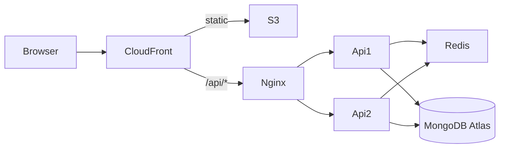

# DSA Sheet

A TypeScript MERN learning app for Apna College’s DSA Sheet assessment: secure student login, a Chapter → Topic → Problem sheet with resources and difficulty, progress that resumes where you left off, and a standalone study calendar.

**Live demo (AWS):** [https://d3o8eouup6tfum.cloudfront.net](https://d3o8eouup6tfum.cloudfront.net)

> 10k–50k concurrent users is a **design target**, not a measured production capacity. See [docs/SYSTEM_DESIGN.md](docs/SYSTEM_DESIGN.md) and [docs/load-test-results.md](docs/load-test-results.md).

## Features

- Register / login with **httpOnly** cookies (access + rotating refresh)
- Public DSA sheet browse; signed-in progress checkboxes and stats
- Resume via `lastActivity` (“continue where you left off”)
- Calendar: plans CRUD, revisit scheduling, auto-generate, activity heatmap
- Redis sheet cache + shared rate limits (optional locally; on in production compose)
- Light theme default + dark theme toggle

## Stack

| Layer | Tech |
| --- | --- |
| Web | React 19, Vite, React Router, TanStack Query, Zustand, Tailwind, FullCalendar v6 (MIT) |
| API | Node 20, Express, Mongoose, Zod, Pino, Helmet, JWT, bcrypt |
| Shared | `packages/shared` (Zod schemas / types) |
| Data | MongoDB (Atlas in prod; Docker locally), Redis (Docker) |
| Deploy | Docker API image → GHCR → EC2 Compose (Nginx + 2×API + Redis), S3 + CloudFront, GitHub Actions OIDC |



## Repository layout

```text
apps/api          Express API
apps/web          React SPA
packages/shared   Shared Zod / types
infra/            Docker, Nginx, CloudFront Function, IAM JSON, k6
docs/             Design, schema, API, ADRs, deployment, load tests
.github/workflows CI + deploy
```

## Local setup (fresh clone)

**Requirements:** Node.js ≥ 20, npm, Docker Desktop (for Mongo + Redis).

```powershell
git clone <this-repo-url>
cd AC-DSA_Sheet
Copy-Item .env.example .env
# Edit .env if needed (defaults match local compose)

docker compose -f infra/docker-compose.yml up -d
npm ci
npm run seed
npm run dev
```

- Web: [http://localhost:5173](http://localhost:5173) (Vite proxies `/api` → API)
- API: [http://localhost:4000](http://localhost:4000)
- Health: [http://localhost:4000/health](http://localhost:4000/health)

## Environment variables

Loaded from the **repo root** `.env` by the API (`apps/api/src/config/env.ts`). The web app has **no** env file (relative `/api`).

| Variable | Required | Purpose | Local example |
| --- | --- | --- | --- |
| `NODE_ENV` | yes | `development` \| `test` \| `production` | `development` |
| `PORT` | no (default 4000) | API listen port | `4000` |
| `MONGO_URI` | yes | Mongo connection | `mongodb://localhost:27017/dsa-sheet` |
| `MONGO_POOL_SIZE` | no (default 50) | Mongoose pool | `50` |
| `REDIS_ENABLED` | no (default false in schema; example uses true) | Enable Redis | `true` |
| `REDIS_URL` | if Redis enabled | Redis URL | `redis://localhost:6379` |
| `JWT_ACCESS_SECRET` | yes (≥8 chars) | Sign access JWTs | local placeholder only |
| `COOKIE_SECURE` | no | Cookie `Secure` flag | `false` locally |
| `CORS_ORIGIN` | yes | Allowed browser origin | `http://localhost:5173` |
| `LOG_LEVEL` | no | Pino level | `info` |
| `RATE_LIMIT_WINDOW_MS` | no | Rate-limit window | `60000` |
| `RATE_LIMIT_API_MAX` | no | General API max / window | `300` |
| `RATE_LIMIT_AUTH_MAX` | no | Auth routes max / window | `30` |
| `SHEET_CACHE_TTL_SECONDS` | no | Sheet tree Redis TTL | `3600` |

Production template: [`.env.production.example`](.env.production.example). Never commit real `.env` files.

## Scripts

| Script | What it does |
| --- | --- |
| `npm run dev` | Build shared, run API + web |
| `npm run build` | Production build (shared, api, web) |
| `npm run typecheck` | Typecheck workspaces |
| `npm run lint` | ESLint |
| `npm test` | Vitest (api + web) |
| `npm run seed` | Upsert sheet content into Mongo |
| `npm run check-seed-links` | Sample URL checks for seed resources |
| `npm run verify-indexes` | Explain plans → `docs/index-explain.json` |
| `npm run load:k6` | k6 load script (`infra/k6/load.js`) |

## Documentation

| Doc | Description |
| --- | --- |
| [docs/SYSTEM_DESIGN.md](docs/SYSTEM_DESIGN.md) | HLD/LLD, auth, progress, scale, trade-offs |
| [docs/DB_SCHEMA.md](docs/DB_SCHEMA.md) | Collections, ER, indexes |
| [docs/API.md](docs/API.md) | HTTP API reference |
| [docs/DEPLOYMENT.md](docs/DEPLOYMENT.md) | Short deploy reference + live URLs |
| [docs/DEPLOYMENT_GUIDE.md](docs/DEPLOYMENT_GUIDE.md) | Step-by-step AWS deploy |
| [docs/LOAD_TESTING.md](docs/LOAD_TESTING.md) / [load-test-results.md](docs/load-test-results.md) | k6 method + P8 numbers |
| [docs/adr/](docs/adr/) | Architecture Decision Records |
| [docs/VIDEO_SCRIPT.md](docs/VIDEO_SCRIPT.md) | 2–5 min demo script (recording link BLOCKED until provided) |

## PDF deliverables

1. Source code — this repository  
2. Live AWS link — https://d3o8eouup6tfum.cloudfront.net  
3. System design — [docs/SYSTEM_DESIGN.md](docs/SYSTEM_DESIGN.md)  
4. DB schema — [docs/DB_SCHEMA.md](docs/DB_SCHEMA.md)  
5. Video — script in [docs/VIDEO_SCRIPT.md](docs/VIDEO_SCRIPT.md); **recording link: BLOCKED**

## License

Private assessment project unless otherwise stated by the author.
