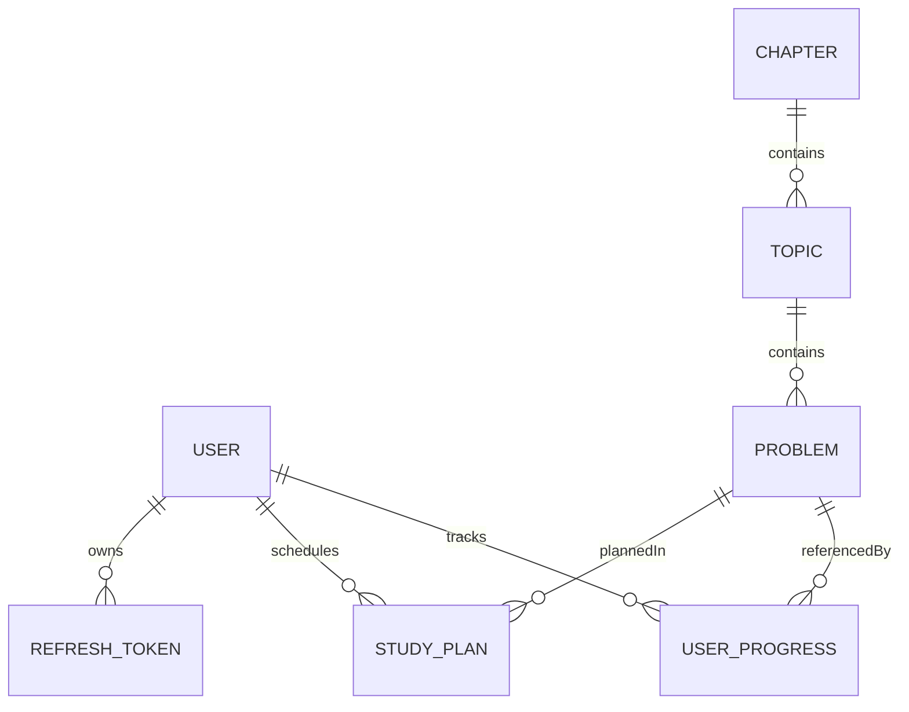

# Database schema

MongoDB via Mongoose. Collection names below are Mongoose defaults (pluralized lowercase).

**Index evidence:** definitions come from the models under `apps/api/src`. Query plans were verified locally with `npm run verify-indexes` → [index-explain.json](./index-explain.json) (all listed queries **IXSCAN**, no COLLSCAN). A fresh `getIndexes()` dump against the live Atlas cluster was not re-run for this document; production uses the same models, which create these indexes on connect.

## ER diagram

## Collections

### `users`

| Field | Type | Notes |
| --- | --- | --- |
| `name` | string | required |
| `email` | string | lowercase, unique index |
| `passwordHash` | string | bcrypt |
| `role` | string | `student` \| `admin` (default student) |
| `lastActivity` | object | optional `{ problemId, topicId, chapterId, at }` |
| `createdAt` / `updatedAt` | dates | timestamps |

**Indexes:** unique `{ email: 1 }`

### `chapters`

| Field | Type | Notes |
| --- | --- | --- |
| `title`, `slug`, `description` | string | slug unique |
| `order` | number | sort |
| timestamps | | |

**Indexes:** unique `{ slug: 1 }`, `{ order: 1 }`

### `topics`

| Field | Type | Notes |
| --- | --- | --- |
| `chapterId` | ObjectId → Chapter | required |
| `title`, `slug` | string | |
| `order` | number | |
| timestamps | | |

**Indexes:** `{ chapterId: 1, order: 1 }`

### `problems`

| Field | Type | Notes |
| --- | --- | --- |
| `topicId`, `chapterId` | ObjectId | chapter denormalized for stats |
| `title`, `slug` | string | slug unique |
| `difficulty` | enum | Easy / Medium / Hard |
| `order` | number | |
| `resources` | object | `youtube`, `article` required; `leetcode` / `codeforces` optional (at least one in seed validation) |
| timestamps | | |

**Indexes:** `{ topicId: 1, order: 1 }`, `{ chapterId: 1 }`, `{ difficulty: 1 }`, unique `{ slug: 1 }`

### `userprogresses` (`UserProgress`)

| Field | Type | Notes |
| --- | --- | --- |
| `userId`, `problemId`, `topicId`, `chapterId` | ObjectId | required |
| `status` | enum | `done` \| `revisit` |
| `completedAt` | date | required |
| `notes` | string | optional |
| timestamps | | |

**Indexes:** unique `{ userId: 1, problemId: 1 }`, `{ userId: 1, chapterId: 1 }`, `{ userId: 1, completedAt: 1 }`

### `studyplans` (`StudyPlan`)

| Field | Type | Notes |
| --- | --- | --- |
| `userId` | ObjectId | required |
| `date` | date | UTC midnight of `YYYY-MM-DD` |
| `title` | string | |
| `problemIds` | ObjectId[] | |
| `topicId` | ObjectId | optional |
| `status` | enum | stored; **derived on read** for list views (planned/done/missed) |
| `note` | string | optional |
| `kind` | enum | `study` \| `revision` \| `generated` |
| timestamps | | |

**Indexes:** `{ userId: 1, date: 1 }`

### `refreshtokens` (`RefreshToken`)

| Field | Type | Notes |
| --- | --- | --- |
| `userId` | ObjectId | indexed |
| `tokenHash` | string | unique |
| `expiresAt` | date | TTL index |
| timestamps | | |

**Indexes:** `{ userId: 1 }`, unique `{ tokenHash: 1 }`, TTL `{ expiresAt: 1 }` `expireAfterSeconds: 0`

## Size note (design estimate)

~50k users × ~400 problems ≈ up to ~20M progress docs if fully dense — why progress is **not** embedded on the user document. Demo seed is far smaller (on the order of ~100 problems).
