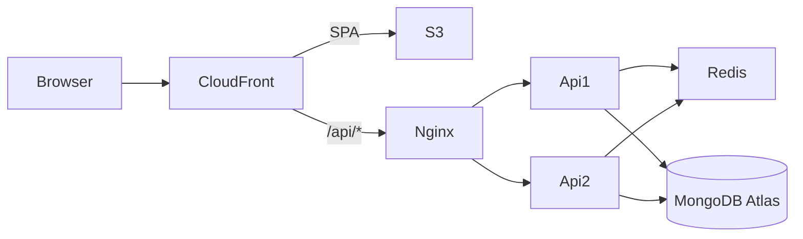
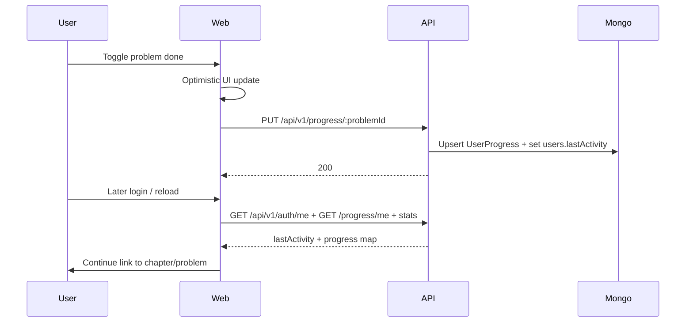

# System design

## 1. Deployed demo vs target design

| | **Deployed demo (what runs today)** | **Target design (10k–50k active users)** |
| --- | --- | --- |
| Compute | One EC2 micro, Docker Compose: Nginx + **api1/api2** + Redis | Larger instances or containers; optional ASG later |
| Data | Atlas **M0**, Redis on the same EC2 | Atlas **M10+**, managed Redis (e.g. ElastiCache) |
| Edge | CloudFront + S3 SPA, `/api*` → EC2 | Same pattern; optional custom domain / WAF |
| Verified load | Local k6 only (see below) | Not load-tested at 10k–50k |

**Do not treat the demo as proof of 10k–50k capacity.**

## 2. High-level architecture

**Request flow (browser)**

1. User opens `https://d3o8eouup6tfum.cloudfront.net`.
2. Static assets come from S3 via CloudFront (SPA Function rewrites deep links to `/index.html`).
3. API calls use same-origin `/api/v1/...` → CloudFront → EC2 Nginx → least-conn to api1/api2.
4. Express uses `trust proxy` so rate limits see the client IP from `X-Forwarded-For`.

## 3. Authentication

- **Register / login** issue JWTs stored in **httpOnly** cookies: `access_token` (short-lived, path `/`) and `refresh_token` (longer, path `/api/v1/auth`).
- `Secure` + `SameSite=Lax` in production (`COOKIE_SECURE=true` behind HTTPS).
- Refresh rotates the refresh token document (hash stored in Mongo; TTL index expires old rows).
- Web axios client (`apps/web/src/lib/http.ts`) retries once via `POST /api/v1/auth/refresh` on 401.
- Passwords: bcrypt hashes on `users.passwordHash` — never returned to clients.

## 4. Progress and resume-on-login

- One **UserProgress** document per `(userId, problemId)` (unique index) — not an array on the user.
- `completedAt` set on first completion (`$setOnInsert` pattern in service).
- `revisit` status can schedule calendar revision plans (P7).
- Stats include difficulty/chapter breakdown, streak, and sparse daily `activity` for the heatmap (C11).

## 5. Data and Redis

- **MongoDB:** content (chapters/topics/problems) + user data (users, progress, plans, refresh tokens). Indexes in [DB_SCHEMA.md](./DB_SCHEMA.md).
- **Redis (when enabled):**
  - Sheet tree cache key (TTL `SHEET_CACHE_TTL_SECONDS`); responses may send `X-Cache: HIT|MISS` and ETags.
  - Shared rate-limit counters (`rl:*`) across API replicas.
- If Redis is down / disabled: API continues; sheet reads Mongo; rate limit falls back to in-memory (per process).

## 6. API design (summary)

- Versioned under `/api/v1`.
- Uniform JSON: `{ success, data }` or `{ success: false, error: { code, message } }`.
- Zod validation via shared schemas (`packages/shared`).
- Stricter rate limit on `/api/v1/auth/*` than other routes.
- Full route list: [API.md](./API.md).

## 7. Caching, rate limiting, scalability levers

| Lever | Demo | Scale-up idea |
| --- | --- | --- |
| Sheet cache | Redis on EC2 | ElastiCache / longer TTL + purge on content change |
| Rate limits | Redis shared | Edge WAF + Redis |
| Reads | Two Node processes | More replicas / ALB (costly — avoided in demo) |
| Writes | Indexed upserts | Shard by userId if needed |
| Static | CloudFront | Already CDN-friendly hashed assets |

## 8. P8 k6 results (local only)

From [load-test-results.md](./load-test-results.md) (localhost API + Docker Mongo/Redis, **not** CloudFront):

| Run | VUs | Result |
| --- | --- | --- |
| C (primary) | 2 / 20s | 0% failures, p95 **32.71ms**, checks 100% |
| B | 2 / 20s (Docker k6) | p95 45.94ms |
| A | 5 VUs aggressive | Failed thresholds — hit `RATE_LIMIT_API_MAX` |

**Limits:** short duration, tiny VU count, single developer machine, rate limiter as intentional bottleneck under burst.

## 9. Trade-offs

- **CloudFront → EC2 over HTTP (R2):** TLS at the edge; SG intended to allow CloudFront only. Simpler/cheaper than ALB+ACM on origin.
- **No distribution-wide SPA error pages (R1):** SPA rewrites via CloudFront Function on S3 behaviour only so API JSON errors stay intact.
- **No Elastic IP in this deploy:** cheaper; Stop/Start requires updating Atlas allowlist + CloudFront origin DNS.
- **Dual API on one micro:** matches design diagram; memory constrained — swap documented for ops, not a capacity proof.

## 10. Improvements (not built)

- Managed Redis, Atlas M10, horizontal API ASG, observability dashboards, custom domain, stricter network isolation, load tests against the live stack.
